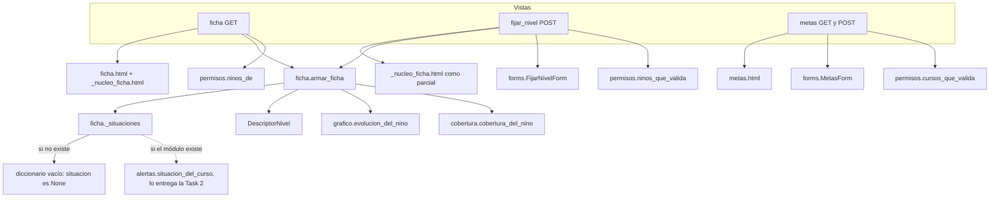
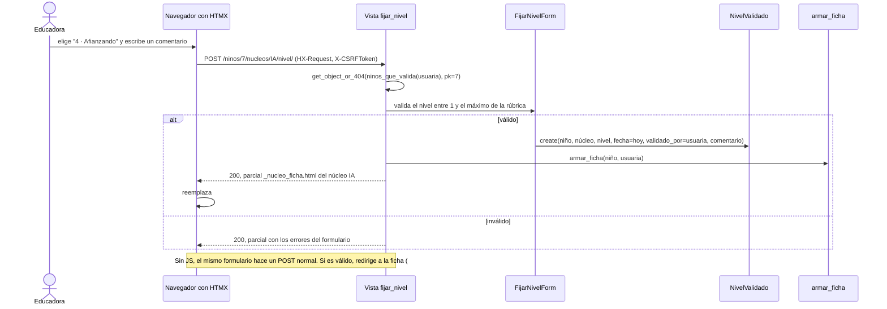

# Documento de diseño: Ficha del niño, validación manual y tabla de metas (Task 3)

## Overview

La Task 3 cierra el flujo sin IA (PLAN.md, Task 3). La educadora abre la ficha de un niño y ve, por núcleo:

- dónde está (nivel actual frente a lo esperado y frente a la mediana del curso);
- qué dice la rúbrica de su nivel y del siguiente;
- la evolución, la evidencia por OA y las observaciones aceptadas.

Desde la misma ficha fija un nivel con un comentario. También edita la tabla de metas del curso.

Casi todo el cálculo ya existe: `cobertura.py`, `grafico.py`, `DescriptorNivel`, `texto_nivel` y `permisos.py`. Lo nuevo:

- `registro/ficha.py`: arma los datos de la ficha;
- `registro/forms.py`: el formulario de nivel y el de metas;
- tres vistas con sus plantillas;
- una función de permisos.

No hay modelos ni migraciones nuevas.

Falta una pieza de la Task 2: `registro/alertas.py` (nivel esperado, mediana y brechas). La Task 3 no lo implementa. Este diseño fija la interfaz que la ficha consume (sección 2), que queda como contrato para la Task 2, y la ficha funciona sin ese módulo: mientras no exista, omite el esperado, la mediana, las señales y el aviso de datos (ver "Decisión: `alertas.py`").

Fuera de alcance: propuestas de nivel con IA, revisión de observaciones, distribución del curso y resumen de la quincena (Task 2), y la vista de la directora (Task 12).

## Architecture



Los cálculos viven en módulos de Python, puros cuando se puede, y las plantillas solo muestran. Así el backend y el frontend se reparten por la frontera "contexto de la plantilla" (ver "Reparto del trabajo").

## Flujo: fijar un nivel



## Components and Interfaces

### 1. Permisos (`registro/permisos.py`)

Una función nueva, con el mismo patrón que las existentes:

```python
def ninos_que_valida(usuario):
    """Niños de los cursos donde el usuario valida niveles (solo la educadora del curso)."""
    return Nino.objects.filter(curso__in=cursos_que_valida(usuario))
```

| Vista | Queryset | Educadora del curso | Asistente | Directora del jardín | Otra educadora |
|---|---|---|---|---|---|
| `ficha` (GET) | `ninos_de` | 200, con formulario | 200, sin formulario | 200, sin formulario | 404 |
| `fijar_nivel` (POST) | `ninos_que_valida` | crea el nivel | 404 | 404 | 404 |
| `metas` (GET y POST) | `cursos_que_valida` | 200 | 404 | 404 | 404 |

- Todas con `@login_required`. `fijar_nivel` con `@require_POST` (un GET responde 405).
- El núcleo se busca con `get_object_or_404(Nucleo, sigla=sigla)`.
- `puede_validar(usuaria, curso)` decide si la ficha incluye el formulario.

### 2. Alertas (`registro/alertas.py`): contrato con la Task 2

La Task 3 no escribe este módulo. Esta sección es el contrato: la Task 2 lo implementa con estas firmas y la ficha lo consume a través de `ficha._situaciones` (sección 3). La ficha solo usa `situacion_del_curso` y los atributos de `SituacionNucleo` y `Senal`; el resto de las funciones queda descrito como guía para la Task 2.

Sigue la guía de la Task 2 del plan. Todas las funciones son puras salvo `situacion_del_curso`, que es la única que consulta la base (mismo patrón que `cobertura_del_nino`). Nada se guarda: se calcula cada vez.

```python
SEMESTRES_DEL_NIVEL = 4   # un nivel educativo dura 2 años
DIAS_SIN_DATOS = 14

class Gravedad(enum.Enum):
    NORMAL = "normal"
    AVISO = "aviso"
    ALERTA = "alerta"

class EstadoDatos(enum.Enum):
    AL_DIA = "al_dia"
    DESACTUALIZADOS = "desactualizados"   # más de 14 días sin observaciones aceptadas
    SIN_DATOS = "sin_datos"               # nunca tuvo

def semestre_de_permanencia(fecha_ingreso: date, hoy: date, semestres: list) -> int | None: ...
def nivel_esperado(semestre: int | None, metas: dict[int, int], nivel_maximo: int) -> int | None: ...
def mediana(niveles: list[int]) -> float | None: ...
def brecha(referencia: float | None, nivel: int | None) -> float | None: ...   # referencia − nivel
def gravedad(brecha: float | None) -> Gravedad | None: ...
def estado_datos(ultima_fecha: date | None, hoy: date, dias: int = DIAS_SIN_DATOS) -> EstadoDatos: ...

@dataclass(frozen=True)
class Senal:
    tipo: str            # "pares" o "esperado"
    brecha: float
    gravedad: Gravedad   # solo AVISO o ALERTA; las normales no se crean

    @property
    def texto(self) -> str: ...   # "Revisar: 3 niveles bajo lo esperado", "Revisar: 2 niveles bajo sus pares"

@dataclass(frozen=True)
class SituacionNucleo:
    nivel: int | None            # nivel actual validado
    esperado: int | None
    mediana_curso: float | None
    senales: list[Senal]         # vacía si todo está en rango normal
    datos: EstadoDatos

def situacion_del_curso(curso, hoy: date | None = None) -> dict[int, dict[str, SituacionNucleo]]:
    """{id del niño: {sigla del núcleo: SituacionNucleo}}. Cantidad fija de consultas."""
```

Contrato de cada función:

- `semestre_de_permanencia`
  - Pre: `semestres` ordenados por inicio (objetos con `inicio` y `fin`).
  - El semestre de ingreso es el primero con `fin >= fecha_ingreso`. Si el niño ingresó en vacaciones, cuenta desde el siguiente. Si ingresó a mitad de semestre, ese semestre cuenta entero.
  - El semestre actual es el último con `inicio <= hoy`. En vacaciones vale el último que empezó.
  - Post: `max(1, actual − ingreso + 1)`. `None` si no hay semestre de ingreso (no hay semestres, o el ingreso es posterior al último).
- `nivel_esperado`
  - Post: `None` si `semestre` es `None`. Si `semestre > SEMESTRES_DEL_NIVEL`, el `nivel_maximo` de la rúbrica. Si no, `min(metas[semestre], nivel_maximo)`, o `None` si falta esa meta.
- `mediana`
  - Post: `None` con la lista vacía. Con un niño, su nivel. Con cantidad par, el promedio de los dos centrales (puede terminar en ,5). No depende del orden de la lista.
- `brecha`
  - Post: `None` si falta alguno de los dos. Positiva significa que el niño está bajo la referencia.
- `gravedad`
  - Post: `None` si la brecha es `None`; `ALERTA` si es mayor que 2; `AVISO` si es exactamente 2; `NORMAL` en otro caso, incluidas las negativas. Con medianas terminadas en ,5: 1,5 es `NORMAL` y 2,5 es `ALERTA`.
- `estado_datos`
  - Post: `SIN_DATOS` si no hay fecha; `DESACTUALIZADOS` si `(hoy − ultima_fecha).days > dias` (14 días está al día, 15 no); `AL_DIA` en otro caso.
- `situacion_del_curso`
  - La mediana de cada núcleo usa el nivel actual de todos los niños del curso, incluido el niño.
  - La última fecha es la de la observación aceptada, no grupal, del niño, etiquetada con el núcleo.
  - El esperado usa las metas del curso, `Semestre` y `Rubrica.nivel_maximo`.

### 3. Armador de la ficha (`registro/ficha.py`)

```python
@dataclass(frozen=True)
class NucleoFicha:
    nucleo: Nucleo
    actual: NivelValidado | None
    texto_actual: str                             # texto_nivel(): "3 · Desarrollando", o "3" si es provisorio
    descriptor_actual: DescriptorNivel | None
    descriptor_siguiente: DescriptorNivel | None  # None en el nivel máximo
    provisorio: bool                              # muestra la etiqueta "Rúbrica provisoria"
    situacion: SituacionNucleo | None             # None si no existe alertas.py o no hay situación del núcleo
    evolucion: Evolucion                          # para _evolucion.html
    cobertura: list[CoberturaOA]
    observaciones: list[Observacion]              # aceptadas, no grupales, del núcleo; las más recientes primero
    form: FijarNivelForm | None                   # solo si puede_validar

    @property
    def pasos_sugeridos(self) -> str: ...         # descriptor_actual.pasos_sugeridos, o ""

    @property
    def aviso_datos(self) -> str: ...             # "" si situacion es None o los datos están al día

@dataclass(frozen=True)
class Ficha:
    nino: Nino
    nucleos: list[NucleoFicha]   # en el orden de Nucleo
    puede_validar: bool

    def nucleo(self, sigla: str) -> NucleoFicha: ...

def descriptores_vecinos(descriptores: dict[int, DescriptorNivel], nivel: int | None
                         ) -> tuple[DescriptorNivel | None, DescriptorNivel | None]: ...   # pura
def es_provisorio(descriptores: dict[int, DescriptorNivel]) -> bool: ...                     # pura
def armar_ficha(nino, usuario, hoy: date | None = None,
                formularios: dict[str, FijarNivelForm] | None = None) -> Ficha: ...

def _situaciones(curso, hoy: date) -> dict[int, dict[str, SituacionNucleo]]:
    """Situación del curso según alertas.py, o {} mientras la Task 2 no lo entregue."""
    try:
        from .alertas import situacion_del_curso
    except ModuleNotFoundError as error:
        if error.name != f"{__package__}.alertas":
            raise                      # falta otro módulo dentro de alertas.py: no se oculta
        return {}
    return situacion_del_curso(curso, hoy)
```

Cómo funciona sin `alertas.py`:

- `armar_ficha` llama a `_situaciones(nino.curso, hoy)` una vez y toma `situaciones.get(nino.pk, {}).get(sigla)` para cada núcleo. Si el módulo no existe, o el niño o el núcleo no aparecen en el resultado, `NucleoFicha.situacion` queda en `None`.
- La importación va dentro de la función, así que `ficha.py` carga aunque el módulo no exista. Los tipos de `alertas` se importan solo para el chequeo de tipos (`from __future__ import annotations` y `if TYPE_CHECKING:`).
- Solo se tolera que falte el módulo `registro.alertas`. Si el módulo existe pero tiene un error, o le falta `situacion_del_curso`, el error se ve (no se oculta un contrato roto).
- `aviso_datos` compara `situacion.datos.value` con `"sin_datos"` y `"desactualizados"` y devuelve "Sin observaciones aceptadas en este núcleo" o "Sin observaciones aceptadas en los últimos 14 días". Así `ficha.py` no importa `EstadoDatos`.
- Cuando la Task 2 agregue `alertas.py` con la interfaz de la sección 2, la ficha lo usa sin cambiar su código.
- Para probar, los tests reemplazan el módulo en `sys.modules`:
  - `monkeypatch.setitem(sys.modules, "registro.alertas", None)` simula que no existe (Python lanza `ModuleNotFoundError` con `name="registro.alertas"`). Este test sigue valiendo después de la Task 2.
  - `monkeypatch.setitem(sys.modules, "registro.alertas", doble)` usa un doble (`tests/doble_alertas.py`): un módulo con `situacion_del_curso(curso, hoy)` que devuelve objetos con los atributos de `SituacionNucleo` y `Senal`, y enums con los mismos `value`.

- `descriptores_vecinos`: devuelve el descriptor del nivel y el del nivel + 1. Cualquiera de los dos puede faltar (por ejemplo, una rúbrica de 9 niveles con 8 descriptores).
- `es_provisorio`: verdadero si el núcleo no tiene descriptores o alguno es provisorio.
- El nombre del nivel solo se usa si el descriptor es oficial, igual que `DescriptorNivel.nombres_por_nucleo`. Los provisorios se muestran con el número ("3", no "3 · Nivel 3").
- `armar_ficha` hace una cantidad fija de consultas, sin importar cuántos núcleos, niveles u observaciones haya: descriptores, niveles, evolución, cobertura, observaciones con `prefetch_related("nucleos")` y, cuando exista `alertas.py`, situación del curso.
- `formularios`: `{sigla: formulario ligado}`, para volver a mostrar uno con errores. El resto se crea sin ligar, con el nivel actual marcado.
- Después de un POST, la vista vuelve a armar la ficha completa y toma `ficha.nucleo(sigla)`. Hay un solo camino de código para la página y para el parcial.

### 4. Formularios (`registro/forms.py`)

```python
METAS_POR_DEFECTO = {1: 1, 2: 3, 3: 5, 4: 7}   # PLAN.md, "Nivel esperado"

@dataclass(frozen=True)
class Opcion:
    valor: int
    texto: str          # "3 · Desarrollando" o "3"
    descripcion: str    # del descriptor; "" si no hay
    marcada: bool

def etiqueta_nivel(nivel: int, descriptor: DescriptorNivel | None) -> str: ...   # pura, usa texto_nivel
def nombres_comunes(nombres_por_nucleo: dict[str, dict[int, str]]) -> dict[int, str]: ...   # pura

class FijarNivelForm(forms.Form):
    nivel = forms.TypedChoiceField(coerce=int, widget=forms.RadioSelect)
    comentario = forms.CharField(required=False, max_length=500,
                                 widget=forms.Textarea(attrs={"rows": 2}))

    def __init__(self, *args, nivel_maximo: int, descriptores: dict[int, DescriptorNivel], **kwargs): ...
    @property
    def opciones(self) -> list[Opcion]: ...
    def guardar(self, nino, nucleo, usuaria, hoy: date) -> NivelValidado: ...

class MetasForm(forms.Form):
    # Un campo por semestre de permanencia: semestre_1 … semestre_4.
    def __init__(self, *args, curso, nivel_maximo: int, nombres: dict[int, str], **kwargs): ...
    def guardar(self) -> list[MetaSemestre]: ...
```

- `FijarNivelForm`
  - Opciones del 1 al máximo de la rúbrica del nivel educativo, cada una con número, nombre y descripción. `opciones` permite dibujar cada radio con su descripción, para comparar antes de decidir.
  - `prefix` = sigla del núcleo, para que los ids no se repitan en la página (`IA-nivel`).
  - `guardar` crea el `NivelValidado` con `fecha=hoy`, `validado_por=usuaria` y el comentario. La fecha y la usuaria nunca vienen del POST.
  - Fijar el mismo nivel actual se permite: queda como una nueva validación en el historial.
  - Si `save()` lanza `ValidationError` (`ValidaNivelMixin`), el error se agrega al formulario.
- `MetasForm`
  - Opciones del 1 al máximo, con `etiqueta_nivel`. Los nombres salen de `nombres_comunes`: un nombre se usa solo si todos los núcleos con rúbrica oficial coinciden (hoy solo IA; Integra usa los mismos nombres en todos).
  - Valores iniciales: las metas del curso; si falta una, `METAS_POR_DEFECTO`.
  - `guardar` hace `update_or_create` por semestre, dentro de una transacción.
  - Se usa un formulario de 4 campos fijos en vez de un formset de `MetaSemestre`: no permite filas repetidas, borrar filas ni semestres fuera de 1 a 4. Las restricciones del modelo y `ValidaNivelMixin` siguen aplicando al guardar.
  - La pantalla aclara que desde el semestre 5 se espera el nivel máximo de la rúbrica.

### 5. Vistas y URLs

```python
# registro/urls.py
path("ninos/<int:nino_id>/", views.ficha, name="ficha"),
path("ninos/<int:nino_id>/nucleos/<str:sigla>/nivel/", views.fijar_nivel, name="fijar_nivel"),
path("cursos/<int:curso_id>/metas/", views.metas, name="metas"),
```

- `ficha(request, nino_id)`: GET. Muestra `registro/ficha.html` con `{"ficha": Ficha, "curso": nino.curso}`.
- `fijar_nivel(request, nino_id, sigla)`: POST.
  - Con HTMX (`HX-Request: true`): si es válido, crea el nivel y responde 200 con el parcial del núcleo y un mensaje con `role="status"` ("Nivel guardado: 4 · Afianzando."). Si no, responde 200 con el parcial y los errores. Se usa 200 porque HTMX 2 no reemplaza el contenido con respuestas 4xx por defecto.
  - Sin HTMX: si es válido, `messages.success` y redirige a `ficha` con `#nucleo-<sigla>`. Si no, muestra la ficha completa con el formulario ligado.
- `metas(request, curso_id)`: GET muestra el formulario. POST válido guarda, deja el mensaje "Metas guardadas." y redirige a `curso`. POST inválido vuelve a mostrar el formulario con errores.

### 6. Plantillas: contrato con el frontend

- `registro/ficha.html` (extiende `base.html`): nombre del niño, curso, enlace a la tabla del curso y, si `ficha.puede_validar`, enlace a "Editar metas del curso". Luego un `` por núcleo.
- `registro/_nucleo_ficha.html`: raíz `<section id="nucleo-{{ nf.nucleo.sigla }}">`. Contenido, en este orden:
  1. Nombre del núcleo y la etiqueta "Rúbrica provisoria" si `nf.provisorio`.
  2. Resumen: nivel actual (`nf.texto_actual`). Solo si hay `nf.situacion`: esperado y mediana del curso; cada señal con su `texto` y una clase por gravedad (`senal-{{ senal.gravedad.value }}`: `senal-aviso`, `senal-alerta`); y `nf.aviso_datos` si no está vacío. Si `nf.situacion` es `None`, el bloque entero se omite, sin texto de reemplazo.
  3. El nivel actual en la rúbrica: nombre, descripción y conducta, con los ejemplos plegados en `<details>`.
  4. "Qué observar después": descripción y conducta del nivel siguiente. No aparece en el nivel máximo.
  5. "Pasos sugeridos", solo si `nf.pasos_sugeridos` no está vacío. No se inventa texto.
  6. Evolución: ``.
  7. Evidencia por OA: código, cantidad y fecha de la más reciente. Los OA sin evidencia llevan el texto "Sin evidencia todavía: sugerencia de qué observar", además del color.
  8. Observaciones aceptadas en `<details>`, con fecha (`d-m-Y`) y cita, o "Sin observaciones aceptadas".
  9. Si `nf.form`: `<form method="post" action="…" hx-post="…" hx-target="#nucleo-IA" hx-swap="outerHTML" hx-disabled-elt="find button">`, con ``, un radio por opción (número, nombre y descripción), el comentario y el botón "Guardar nivel".
- `registro/metas.html`: un campo por semestre (1 a 4), la nota del semestre 5 en adelante y el botón "Guardar metas".
- `static/registro/registro.css`, cargado en ``: colores de las señales con contraste suficiente y ajustes mínimos sobre Pico. Pensado primero para celular: una columna; las tablas anchas van dentro de `overflow-auto`.
- Si el frontend pliega cada núcleo en `<details>`, el parcial se devuelve abierto.
- Redacción: las señales son sugerencias de revisión ("Revisar: …"), nunca diagnósticos. Los OA sin evidencia indican qué observar, no una falta del niño.

## Data Models

No hay modelos nuevos ni migraciones. Se usan los existentes:

| Modelo | Uso en la Task 3 |
|---|---|
| `NivelValidado` | historial; `fijar_nivel` crea uno con `validado_por`, `fecha` y `comentario` |
| `MetaSemestre` | tabla de metas; `MetasForm` hace `update_or_create` por semestre |
| `DescriptorNivel` | nombre, descripción, conducta, ejemplos, pasos sugeridos y `provisorio` |
| `Rubrica` | `nivel_maximo(nivel_educativo)`, única fuente del máximo |
| `Observacion` | aceptadas, no grupales, del niño (solo lectura) |
| `Semestre` | permanencia del niño (en `alertas.py`) |

Los objetos nuevos son dataclasses sin persistencia: `Ficha`, `NucleoFicha`, `Opcion`, `Senal` y `SituacionNucleo`.

Reglas de validación:

- Nivel entre 1 y `Rubrica.nivel_maximo`: se valida en el formulario (opciones) y otra vez en `save()` (`ValidaNivelMixin`).
- Comentario opcional, de hasta 500 caracteres.
- Metas: un valor por semestre de permanencia del 1 al 4, cada uno entre 1 y el máximo.

## Decisión: `alertas.py` (la Task 2 no está disponible)

> Actualización 15-10, al integrar la Task 2: `alertas.py` llegó con otra interfaz (`tabla_del_curso`, `Celda`, `Brecha`, `EstadoDatos.DESACTUALIZADO`) en vez de `situacion_del_curso` de la sección 2. La ficha la consume directamente: `ficha.situaciones_desde_tabla` convierte la `TablaCurso` en un `SituacionNucleo` por niño y núcleo, así la ficha y la tabla del curso muestran las mismas señales. Ya no hay modo "sin `alertas.py`" ni doble en los tests, y los dos puntos diferidos (editar metas cambia las alertas; subir un nivel hace desaparecer la alerta) están cubiertos en `tests/test_ficha.py`. La sección 2 queda como registro histórico.

Decisión: (a), elegida por el equipo el 15-10.

Contexto: hoy no existen `registro/alertas.py` ni observaciones en los datos de demo, y no hay rama remota de la Task 2. La ficha necesita el esperado y la mediana. La demo de la Task 3 ("se sube un nivel a mano y la alerta desaparece") necesita las señales. Las opciones evaluadas fueron:

| | (a) Esperar a la Task 2 | (b) La Task 3 implementa una versión mínima |
|---|---|---|
| Qué hace la Task 3 | Programa contra la interfaz de la sección 2. `situacion` queda en `None` y la ficha omite el esperado, la mediana y las señales hasta que llegue `alertas.py`. | Escribe `alertas.py` con las funciones puras y `situacion_del_curso` de la sección 2, con tests escritos antes que el código, siguiendo exactamente la guía y los bordes de la Task 2. |
| Qué queda para la Task 2 | Todo `alertas.py`. | Distribución del curso, resumen de la quincena, tabla del curso con señales y datos de demo. Reutiliza `alertas.py` sin cambiar firmas. |
| Bloquea | El test "editar metas cambia las alertas" y la parte de la demo con alertas. | Nada de la Task 3. |
| Riesgo | Llegar al viernes sin la comparación en la ficha. | Choque si la Task 2 ya escribió `alertas.py` en local. Se mitiga avisando al equipo antes de empezar y respetando la interfaz. |

Consecuencias de (a) para la Task 3:

- No implementa `registro/alertas.py`. La sección 2 queda como contrato para la Task 2, sin cambios de firma.
- La ficha consume `alertas.py` solo a través de `ficha._situaciones` (sección 3). Sin el módulo, `NucleoFicha.situacion` es `None` y la plantilla omite el esperado, la mediana, las señales y el aviso de datos.
- Lo que no depende de `alertas.py` se entrega completo: permisos, formularios, `fijar_nivel`, guardar metas, descriptores, evolución, cobertura, observaciones, pasos sugeridos y `texto_nivel`.
- Diferido hasta la Task 2: el test "editar metas cambia las alertas" y la parte de la demo "la alerta desaparece". En la Task 3 se prueba que editar metas guarda los valores, que la ficha omite la situación sin `alertas.py` y que la muestra con un doble que cumple la interfaz.
- El riesgo aceptado es llegar al viernes sin la comparación en la ficha. Al llegar la Task 2, la comparación aparece sin tocar el código de la ficha.

Nota para la demo: con los datos actuales todos los niños están en nivel 1 y sin observaciones. En la Task 3, la demo muestra la ficha de un niño, fija "3 · Desarrollando" en IA con el formulario y muestra la evolución con el punto nuevo y los OA sin evidencia ("Sin evidencia todavía: sugerencia de qué observar"). La parte de alertas (por ejemplo, Pedro Salinas lleva 3 semestres: esperado 5, actual 1, alerta; desaparece al subirlo a 4) llega con la Task 2.

## Reparto del trabajo

- Backend: `permisos.ninos_que_valida`, `ficha.py` (con `_situaciones`), `forms.py`, vistas, URLs, el doble de `alertas` para tests y los tests. Entrega plantillas mínimas, sin estilo, para que los tests de vistas pasen.
- Frontend (fpereira3): `ficha.html`, `_nucleo_ficha.html`, `metas.html` y `registro.css`. Mejora las plantillas mínimas sin cambiar los nombres del contexto.
- Frontera: `Ficha`, `NucleoFicha`, `FijarNivelForm.opciones`, `MetasForm`, los ids `nucleo-<sigla>` y los nombres de URL. Un cambio en esta frontera se acuerda entre los dos.

### Cambios pendientes en `curso.html` (territorio de la Task 2)

- Mostrar el nivel con `texto_nivel` ("3 · Desarrollando"). La vista `curso` debe pasar `DescriptorNivel.nombres_por_nucleo`.
- Enlazar el nombre de cada niño a su ficha.
- Enlace "Editar metas del curso", solo para la educadora (`puede_validar`).

Si la Task 2 aún no tocó `curso.html`, la Task 3 hace estos tres cambios mínimos y avisa. Si ya lo cambió, se le piden a la Task 2.

## Error Handling

### Nivel fuera de rango o no numérico

- Condición: un POST con un nivel que no está entre 1 y el máximo (por ejemplo, manipulado a mano).
- Respuesta: el formulario es inválido ("Elige un nivel entre 1 y N") y se devuelve el parcial con el error. No se crea `NivelValidado`.
- Respaldo: si el valor llegara a `save()`, `ValidaNivelMixin` lanza `ValidationError` y el error se agrega al formulario.

### Sin permiso o recurso inexistente

- Condición: niño o curso ajeno, asistente o directora que hace POST, o sigla inexistente.
- Respuesta: 404, sin revelar si el recurso existe. No cambia nada en la base.

### Nivel sin descriptor

- Condición: la rúbrica tiene más niveles que descriptores (por ejemplo, 9 niveles y 8 descriptores).
- Respuesta: la opción se muestra solo con el número y sin descripción. La ficha muestra el nivel con el texto "Sin descriptor en la rúbrica para este nivel".

### `alertas.py` todavía no existe

- Condición: la Task 2 no entregó `registro/alertas.py`.
- Respuesta: `_situaciones` devuelve `{}`, cada `NucleoFicha.situacion` es `None` y la ficha se muestra sin el bloque de esperado, mediana, señales y aviso de datos. Responde 200, como siempre.
- Si el módulo existe pero falla al importar por otra causa, el error no se oculta (500 en desarrollo, visible en los tests).

### Dos validaciones el mismo día

- Vale la última registrada, igual que en `Nino.nivel_actual` y `puntos_evolucion`.

### Doble envío

- `hx-disabled-elt` desactiva el botón mientras la petición está en curso. Sin JS, el segundo envío crea otra validación igual, que es inofensiva en el historial.

### Riesgos aceptados para el MVP

- Sesión vencida durante un POST con HTMX: `login_required` redirige y HTMX metería el login dentro de la sección. Se acepta; recargar la página lleva al login.
- Curso sin `Rubrica` para su nivel educativo: `Rubrica.nivel_maximo` lanza un error y la vista responde 500. No se maneja, porque `cargar_demo` siempre crea la rúbrica; un error aquí indica datos mal cargados.

## Correctness Properties

### Property 1: Opciones del formulario

Para todo máximo N ≥ 2 y cualquier conjunto de descriptores, las opciones son exactamente 1..N en orden, con "n · nombre" si el descriptor es oficial y tiene nombre, y "n" si no.

**Validates: Requirements 5.1**

### Property 2: Rango del nivel

Para todo entero, el formulario es válido si y solo si está entre 1 y N; si no es válido, el historial no cambia.

**Validates: Requirements 5.5, 5.6, 6.5**

### Property 3: Fijar un nivel actualiza el actual

Para cualquier historial y nivel válido, después de guardar, el historial creció en uno, `nivel_actual` es el nivel fijado y `validado_por` es la usuaria.

**Validates: Requirements 6.1, 6.3, 6.4**

### Property 4: Vecinos en la rúbrica

Para todo nivel entre 1 y N con descriptores completos, el siguiente es el del nivel + 1, y no hay siguiente en N.

**Validates: Requirements 2.6, 2.7**

### Property 5: Metas de ida y vuelta

Para cualquier conjunto de metas válidas, guardarlas y volver a abrir el formulario muestra los mismos valores.

**Validates: Requirements 7.5, 7.7**

### Property 6: Permisos

Para toda usuaria que no es la educadora del curso, el POST a `fijar_nivel` o a `metas` responde 404 y no cambia la base.

**Validates: Requirements 1.7, 1.9**

### Propiedades para la Task 2

Son propiedades de `alertas.py` (sección 2). La Task 3 no implementa ese módulo ni las prueba; quedan como guía para los tests de la Task 2.

- Gravedad: para toda brecha b, la gravedad es `ALERTA` si b > 2, `AVISO` si b = 2 y `NORMAL` si b < 2; y no decrece al crecer b.
- Mediana: para toda lista no vacía, la mediana queda entre el mínimo y el máximo y no depende del orden.
- Nivel esperado: para todo semestre mayor que 4, el esperado es N; para todo semestre de 1 a 4 con meta, es el mínimo entre la meta y N.
- Permanencia: para toda fecha de ingreso y par de fechas hoy₁ ≤ hoy₂, la permanencia es al menos 1 y no decrece.

## Testing Strategy

### Tests unitarios y de vistas

- pytest y pytest-django, con los fixtures de `conftest.py` (`rubrica`, `nucleos`, `educadora`, `otra_educadora`, `asistente`, `directora`, `jardin`, `curso`). Fixtures nuevos: `nino`, `descriptores_ia` (oficiales, con nombre y conducta) y `rubrica_9` (9 niveles).
- Vistas con `client`; el parcial se pide con `HTTP_HX_REQUEST="true"`.
- Tests del plan:
  - validar un nivel crea historial y la tabla del curso muestra el nivel nuevo;
  - editar metas guarda los valores y el formulario los vuelve a mostrar (el test "editar metas cambia las alertas" queda diferido hasta la Task 2);
  - con una rúbrica de 9 niveles se puede fijar el 9;
  - la ficha muestra los pasos sugeridos cuando existen y oculta la sección cuando no;
  - una asistente o la directora que intentan fijar un nivel o editar metas reciben 404.
- Situación del curso, sin depender de la Task 2:
  - con `sys.modules["registro.alertas"] = None`, la ficha responde 200 y no muestra esperado, mediana, señales ni aviso de datos;
  - con el doble de `tests/doble_alertas.py`, la ficha muestra el esperado, la mediana, el texto de cada señal con su clase y el aviso de datos;
  - un `ModuleNotFoundError` de otro módulo dentro de `alertas` no se oculta.
- Además: la ficha muestra "Rúbrica provisoria" solo en los núcleos provisorios; el nivel siguiente no aparece en el máximo; sin JS, el POST redirige a la ficha; `armar_ficha` hace una cantidad fija de consultas (`django_assert_max_num_queries`).
- Los tests de bordes de `alertas.py` (brecha 2 frente a 3, mediana con cantidad par y con un solo niño, 14 frente a 15 días, ingreso a mitad de semestre y fechas de vacaciones) son de la Task 2.

### Tests basados en propiedades

- Librería: Hypothesis, solo en `requirements-dev.txt` y con versión fija.
- Solo para funciones puras de la Task 3: `etiqueta_nivel` y `FijarNivelForm.opciones` (propiedad 1), el rango del formulario (propiedad 2) y `descriptores_vecinos` (propiedad 4). Mínimo 100 ejemplos por propiedad. `es_provisorio` se prueba con ejemplos.
- Las propiedades que tocan la base (3: fijar un nivel; 5: metas de ida y vuelta; 6: permisos) y la parte "el historial no cambia" de la propiedad 2 se prueban con `pytest.mark.parametrize` sobre niveles, metas y roles, no con Hypothesis. Son parte de los tests de vistas.
- La Task 3 no prueba `alertas.py` con Hypothesis ni con ejemplos: las propiedades de "Propiedades para la Task 2" son de la Task 2.
- Los tests con Hypothesis son opcionales: si no alcanza el tiempo, quedan los tests de bordes con ejemplos.
- Cada test de propiedad lleva el comentario `# Feature: task3-ficha-nino, Property N: <texto>`.

## Security Considerations

- Todas las vistas piden login y filtran con los querysets de `permisos.py`. Lo ajeno responde 404.
- Validar niveles y editar metas queda solo en la educadora del curso. `validado_por` y la fecha salen de la sesión y del servidor, no del POST.
- CSRF: `` en cada formulario (sirve sin JS) y `hx-headers` de `base.html` para HTMX.
- Las citas, comentarios y textos de la rúbrica pasan por el autoescape de Django. Solo el SVG de `grafico.py`, que ya escapa su texto, se inserta sin escapar.
- La Task 3 no envía datos a servicios externos.

## Dependencies

- En el repo: Django 5.2.18, HTMX 2.0.11 y Pico.css 2.1.1 en `static/vendor/`, pytest 9.1.1 y pytest-django 4.14.0.
- Nueva y opcional: Hypothesis, solo para desarrollo, con versión fija.
- Internas: `cobertura.py`, `grafico.py` y `_evolucion.html`, `permisos.py`, `DescriptorNivel` y `texto_nivel`, la rúbrica de Integra cargada por `cargar_demo`.
- Futura: `alertas.py`, que entrega la Task 2 con la interfaz de la sección 2. La ficha funciona sin él (ver "Decisión: `alertas.py`").
