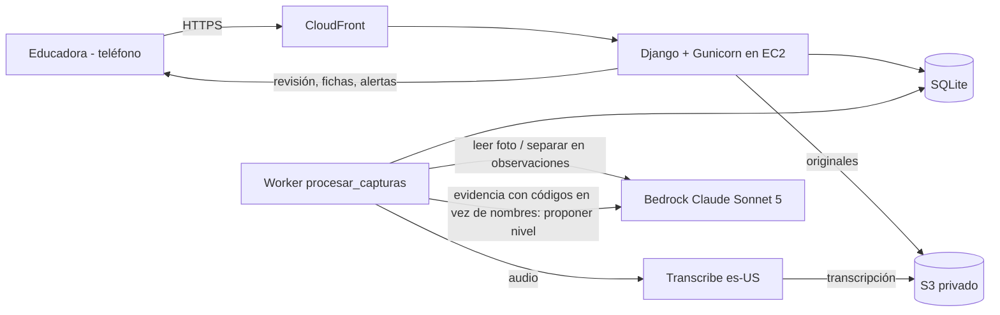

# Plan de implementación: Desafío 1 Fundación Integra

AWS Breaking Barriers Chile 2026. Entrega: viernes 16 de octubre, 14:00 (MVP + pitch de menos de 10 minutos).

## Problema

Las educadoras de Integra dedican unas 4 horas a la semana (más de 11.000 horas semanales en toda la institución) a transcribir y ordenar observaciones escritas a mano, para ubicar a cada niño en un nivel (hoy del 1 al 8) en cada núcleo de aprendizaje. El MVP:

- convierte notas, fotos y audios puntuales en observaciones ordenadas por niño;
- propone un nivel por núcleo con la evidencia que lo respalda;
- avisa cuando un niño va atrasado respecto de sus pares o de lo esperado, o cuando faltan datos recientes.

La educadora siempre decide el nivel.

## Requisitos

### Modelo pedagógico

- 3 niveles educativos (sala cuna, medio, transición). Según las Bases Curriculares, cada nivel abarca 2 años y sus OA describen lo esperado al final del tramo: 50 en sala cuna, 71 en medio y 85 en transición.
- La rúbrica de Integra tendrá 10 núcleos y hoy tiene 8 niveles por núcleo, que podrían pasar a 9 (`contexto/respuestas-integra.md`). Por eso la cantidad de núcleos y de niveles es un dato de la rúbrica, editable, y nada en el código asume 8.
- Núcleos de la demo (Bases Curriculares 2018, confirmados por el Programa Pedagógico de Transición del MINEDUC): Identidad y Autonomía (IA), Convivencia y Ciudadanía (CC), Corporalidad y Movimiento (CM), Lenguaje Verbal (LV), Lenguajes Artísticos (LA), Exploración del Entorno Natural (EEN), Comprensión del Entorno Sociocultural (CES), Pensamiento Matemático (PM). En Transición suman 85 OA. Son los únicos con OA oficiales; se reemplazan por los 10 de Integra cuando entregue la lista.
- La rúbrica se guarda por nivel educativo, porque varía entre ellos: la de Integra trae textos distintos para sala cuna, medio y transición, y en cada uno los niveles van del 1 al 8. La demo usa solo Transición (NT1 y NT2, 4 a 6 años).
- Rúbrica oficial de Integra (`datos/rubrica_integra.json`, ver "Rúbrica de Integra" en Contexto): hoy trae solo Identidad y Autonomía (IA), en los 3 niveles educativos. Cada nivel tiene nombre, descripción, conducta observable, dos ejemplos de registro y orientaciones (los pasos a seguir, todavía vacíos). Los nombres son los mismos en los 3 niveles educativos: 1 Comenzando, 2 Explorando, 3 Desarrollando, 4 Afianzando, 5 Integrando, 6 Ampliando, 7 Consolidando, 8 Profundizando. Para IA reemplaza a la rúbrica provisoria.
- Los otros 7 núcleos de la demo siguen con la rúbrica provisoria, derivada de las conductas del Programa Pedagógico de Transición (`contexto/hallazgos-programa-pedagogico-transicion.md`) y marcada como provisoria. Mapeo provisorio, para 8 niveles: 1 = lo esperado al iniciar NT1; 2 a 4 = conductas de NT1, desde "con ayuda" hasta "autónomo"; 5 a 7 = lo mismo con las conductas de NT2; 8 = conductas de NT2 de forma autónoma. La rúbrica de Integra no sigue esta lógica de apoyo: cada nivel retoma la redacción de uno o dos OA del núcleo y suma conductas más complejas. Cuando Integra entregue cada núcleo, su texto reemplaza al provisorio sin cambiar código.
- Todo niño entra al sistema en nivel 1 en todos los núcleos de su nivel educativo. Solo la educadora cambia niveles.
- El nivel se decide por la conducta observable y los avances del niño, no por una cantidad mínima de observaciones (respuesta de Integra). La propuesta de nivel no usa umbrales de cantidad.
- El tiempo se mide en semestres escolares, con fechas editables.
- Nivel esperado: tabla por curso, editable por la educadora, según el semestre de permanencia del niño. Valores por defecto: 1, 3, 5 y 7 para los semestres 1 a 4 (en la rúbrica de Integra: Comenzando, Desarrollando, Integrando y Consolidando); al egresar se espera el nivel máximo de la rúbrica (hoy 8, Profundizando). Son nuestros: la rúbrica de Integra no asigna niveles a semestres. No se asume que el avance sea lineal. Es una referencia blanda: las Bases Curriculares prescriben por tramos de 2 años porque una prescripción más corta "no respetaría diferencias individuales en el aprendizaje".
- Rezago: Integra lo evalúa comparando al niño con sus pares del nivel. Se muestran dos señales por núcleo, ambas redactadas como sugerencias de revisión, "sin juicios perentorios", como piden las Bases Curriculares:
  - Bajo sus pares (señal principal): mediana del curso − nivel del niño. 2: aviso. Más de 2: alerta.
  - Bajo lo esperado: nivel esperado − nivel actual validado. 2: aviso. Más de 2: alerta.

  Los umbrales son nuestros y provisorios.
- Distribución del curso: por núcleo, cuántos niños hay en cada nivel y en qué nivel está la mayoría.
- Evolución individual: la ficha muestra, por núcleo, la línea de tiempo de los niveles validados.
- Vista del jardín para la directora: por núcleo, el promedio de cada curso del mismo nivel educativo. Si un curso queda 2 o más niveles bajo el promedio de los demás, se muestra una alerta. Es el ejemplo de Integra: dos salas de nivel medio en 6 y una en 3.
- Pasos a seguir: en la rúbrica de Integra son las "orientaciones" de cada nivel, que hoy vienen vacías. La app las carga desde el JSON cuando lleguen (o desde el panel de administración) y la ficha las muestra si existen. Mientras tanto, la ficha muestra la descripción y la conducta del nivel siguiente como referencia de qué observar, sacadas de la misma rúbrica. El MVP no genera pasos con IA.
- Aviso de datos desactualizados si un núcleo de un niño pasa 14 días sin observaciones aceptadas, y aviso "sin datos" si nunca tuvo.
- Cobertura de evidencia por OA: para cada niño, cuántas observaciones aceptadas respaldan cada OA de su nivel educativo y la fecha de la más reciente. Los OA sin evidencia se destacan como sugerencia de qué observar.
- Vista del grupo por quincena (del 1 al 15 y del 16 a fin de mes, según la fecha de la observación). Por núcleo muestra las observaciones aceptadas del curso y cuántos niños tienen al menos una. Los núcleos sin observaciones se destacan, porque la Política de Calidad de Integra pide una oferta que cubra todos los núcleos en cada quincena. Se puede volver a quincenas anteriores.

### Captura y procesamiento

- La educadora (1 por sala) y las asistentes de párvulo (1 cada 7 niños) registran desde su teléfono personal, con conexión: texto, foto (post-it o trabajo del niño) o audio corto. Sin video y sin grabación continua. Revisar observaciones y validar niveles queda en la educadora (decisión nuestra, por confirmar con Integra).
- Una nota que menciona a varios niños genera una observación por niño.
- Cada observación se etiqueta con sus núcleos y, cuando se pueda, con sus OA ("OA 4 LV"). Registra el nivel de apoyo (autónomo, con ayuda, parcial, no lo realiza o sin dato) y separa lo que el niño hizo o dijo de la interpretación de la educadora, como el registro anecdótico del programa.
- Las notas sobre el grupo completo (por ejemplo, "bajó la asistencia") quedan como contexto del curso y no se usan para evaluar.
- Los nombres se emparejan con la lista del curso, tolerando variantes de escritura (Naiara/Nayara). Si un nombre es ambiguo o desconocido, decide la educadora.
- El sistema propone un nivel actual por núcleo considerando toda la evidencia aceptada y citando las observaciones que lo respaldan. La educadora acepta, fija otro nivel o rechaza. Nada se aplica solo.
- Los archivos originales se guardan, y cada observación enlaza a su fuente.

### Alcance

- Dentro: perspectiva de la educadora (su curso, con comparación con pares y evolución individual), registro por asistentes, nivel Transición, un curso de 15 niños cargados a mano, datos 100% ficticios.
- Dentro si alcanza el tiempo (Task 12; si no, va en el pitch): vista del jardín para la directora, con un segundo curso de Transición en los datos de demo.
- Fuera del MVP (se mencionan en el pitch): vista nacional, generar pasos a seguir o actividades con IA, informes a familias, video, modo sin conexión, carga masiva de niños y otros niveles educativos.
- Descartado por el equipo: un registro propio de la voz del niño (sus intereses, preferencias o autoevaluación).
- Descartado por el equipo: usar el dataset sintético E-1 de la organización (0 a 36 meses, 9 niveles y 5 dominios, con nivel esperado por edad), como rúbrica o como datos de demo. Integra pidió pensar la herramienta en 10 núcleos y la demo usa solo Transición. Se sacó del repo. Si más adelante se amplía a sala cuna y medio, sus OA oficiales están en las Bases Curriculares.

### Equipo

- 5 personas: 4 de computación y 1 de ingeniería eléctrica. Conocen JS, CSS, HTML, SQLite, Flask y Django.
- Cuenta AWS de workshop compartida por el equipo, región us-east-1.

### Supuestos pendientes de confirmar

- La tabla de metas es por curso, no por niño.
- El mapeo provisorio de niveles a las conductas de NT1 y NT2 es una hipótesis nuestra y solo se usa en los núcleos sin rúbrica de Integra (hoy, todos menos IA).
- La rúbrica de Integra está en `datos/rubrica_integra.json`, pero solo cubre IA y sin orientaciones. Su fuente dice "borrador entregado el 15-10-2026", así que los textos pueden cambiar. Faltan los otros núcleos, la lista de sus 10 núcleos y una referencia institucional del nivel esperado.
- Que los niveles 1 a 8 de Integra abarcan los 2 años del nivel educativo (NT1 y NT2 en Transición) y que el 8 es lo esperado al egresar. La rúbrica no lo dice; lo suponemos porque cada nivel educativo parte de nuevo en 1.
- Que todo niño entra en nivel 1. En la primera reunión, la mentora dijo otra cosa: "nivel 1 bajo lo esperado al ingreso, nivel 2 lo esperado al ingreso, nivel 8 por sobre lo esperado". Si se confirma, cambian el nivel inicial y la meta del semestre 1.
- Qué OA retoma cada nivel de IA (por ejemplo, nivel 1 ≈ OA 1 IA, nivel 2 ≈ OA 3 IA, nivel 5 ≈ OA 12 IA) es una lectura nuestra de los textos.
- Los umbrales de rezago (2 niveles bajo la mediana del curso; un curso 2 niveles bajo los demás del jardín) son nuestros.
- Las asistentes registran, pero no revisan ni validan.

## Contexto

### Cuenta AWS (revisada el 14 de octubre)

Detalle de modelos, límites, formatos y precios en `docs/investigacion_servicios.md`.

- Rol `WSParticipantRole` en una cuenta de workshop, que puede borrarse al terminar el evento. Por eso la infraestructura va en una plantilla que se puede volver a ejecutar, y el código en git.
- Bedrock: el workshop solo permite algunos modelos. Sonnet 5.5 y Haiku 5.5 están bloqueados. `us.anthropic.claude-sonnet-5` fue probado y funciona. Haiku 4.5 (`us.anthropic.claude-haiku-4-5-20251001-v1:0`) está permitido como opción más barata.
- La simulación de permisos aprueba EC2, S3, KMS, CloudFront, Transcribe (incluido vocabulario personalizado), Polly (4 voces es-US) y creación de roles IAM. La simulación puede no reflejar todas las restricciones del evento.
- App Runner ya no acepta clientes nuevos; no se usa.

### Respuestas de Integra por correo

Detalle en `contexto/respuestas-integra.md`.

- Confirman el enfoque: la herramienta organiza y propone un nivel con evidencia, y la educadora lo ajusta. Quieren niveles "sí o sí".
- Piden ver la evolución individual, en qué nivel está la mayoría del curso con alarma para los rezagados, y una alerta para la directora cuando un curso del jardín está bajo los demás del mismo nivel.
- La rúbrica está en ajuste. Serán 10 núcleos; hoy son 8 niveles y podrían ser 9, y ambos parámetros deben ser ajustables.
- El nivel se decide por la conducta observable y los avances, no por la cantidad de observaciones.
- Observan la educadora (1 por sala) y las asistentes (1 cada 7 niños).
- El rezago se mide contra los pares del nivel. La información se actualiza todo el tiempo.
- Los pasos a seguir vendrán en su rúbrica; quieren poder cargarlos a futuro.

### Rúbrica de Integra (recibida el 15 de octubre)

Archivo `datos/rubrica_integra.json`. Es la rúbrica oficial de progresión, en versión borrador.

- Trae un solo núcleo, Identidad y Autonomía (IA), con un bloque por nivel educativo: sala cuna, medio y transición. Es el "ejemplo de un núcleo" que mencionaron por correo.
- 8 niveles por nivel educativo, con los mismos nombres en los tres: Comenzando, Explorando, Desarrollando, Afianzando, Integrando, Ampliando, Consolidando y Profundizando.
- Cada nivel tiene:
  - `descripcion`: qué logra el niño, en el lenguaje de los OA;
  - `conducta`: la conducta observable típica;
  - `ejemplos`: dos situaciones concretas, escritas como registros anecdóticos (en Transición IA son 16 en total);
  - `orientaciones`: los pasos a seguir, hoy en `null` en todos los niveles.
- En Transición, los textos retoman la redacción de los OA de IA de las Bases Curriculares y avanzan en complejidad (por ejemplo, el nivel 8 habla de perseverar en proyectos y regular emociones de forma flexible). No usa la escala de apoyo del Programa (con ayuda, autónomo): la ayuda del adulto aparece solo en los primeros niveles.
- No indica a qué semestre corresponde cada nivel, ni cómo se reparte entre NT1 y NT2.

### Referente Curricular Integra 2025 (pp. 80–101)

El PDF no se versiona; estos son sus puntos relevantes.

- La evaluación tiene tres pasos: recoger información (observación y registro), juicio valorativo del equipo y toma de decisiones. La herramienta automatiza el primero y prepara el segundo.
- La documentación pedagógica oficial ya es multimodal: notas, fotos, audio, video, transcripción de lo que dicen los niños y sus trabajos.
- Pide registro objetivo: separar lo que el niño dijo o hizo de la interpretación.
- "Aprendizajes emergentes": una observación puede tocar núcleos distintos de los que buscaba la actividad.
- El documento presenta la documentación como un acto reflexivo. Mensaje para el pitch: eliminamos transcribir y ordenar, no la reflexión pedagógica.

### Política de Calidad Educativa de Integra (2017)

Detalle en `contexto/hallazgos-politica-calidad-educativa-integra.md`. El PDF no se versiona porque tiene derechos reservados.

- En 2017, el sistema de evaluación de Integra usaba tres instrumentos:
  - EEDP: desarrollo psicomotor de 0 a 2 años.
  - IEA "Evaluar para aprender": "niveles de logro y movilidad de los aprendizajes"; orienta la planificación y retroalimenta a las familias.
  - PLAEP-R: estandarizado, aplicado a una muestra.

  La herramienta registra la misma movilidad que mide el IEA. Falta confirmar si el instrumento de niveles (hoy 8) lo reemplazó.
- Define la calidad con centro en "el bienestar, el aprendizaje oportuno y pertinente y el protagonismo de los niños y niñas".
- Su vocabulario curricular es anterior a las Bases Curriculares 2018 y no se usa en la app.

### Bases Curriculares de la Educación Parvularia (MINEDUC, 2018)

El PDF no se versiona: [fuente](https://www.curriculumnacional.cl/614/articles-69957_bases.pdf). Detalle en `contexto/hallazgos-bases-curriculares.md`.

- Fijan oficialmente 8 núcleos y 3 niveles de 2 años. Los OA describen lo esperado al final de cada nivel: 206 en total (50 en sala cuna, 71 en medio y 85 en transición).
- Su enfoque de evaluación coincide con la herramienta:
  - la evidencia sale de situaciones cotidianas (fotografías, grabaciones, observaciones), sin instancias formales;
  - "reunidas las evidencias, el o la educadora debe construir una conclusión evaluativa", considerando la distancia entre lo que el niño hace y lo que plantea el OA;
  - todo "sin juicios perentorios".
- No traen conductas observables por año. Sus OA de sala cuna y medio son la fuente oficial si el alcance se amplía más allá de Transición.

### Programa Pedagógico de Transición (MINEDUC, 2019)

El PDF no se versiona: [fuente](https://www.curriculumnacional.cl/614/articles-210511_programa.pdf). Detalle en `contexto/hallazgos-programa-pedagogico-transicion.md`.

- Confirma los 8 núcleos y trae los 85 OA de Transición, cada uno con conductas observables separadas para NT1 y NT2: unas 500 en total, entre 1.000 y 2.000 palabras por núcleo. Caben en el prompt sin búsqueda vectorial.
- Por núcleo describe lo esperado al iniciar NT1 y cómo continúa en Enseñanza Básica.
- Trae formatos de registro (anecdótico, con foco en núcleo y OA, fotográfico) y una escala según autonomía: autónomo, con ayuda, parcial con ayuda, no lo realiza.
- No trae los niveles de Integra ni cubre sala cuna o nivel medio.

### Por verificar durante la implementación

- Que Transcribe acepte los formatos de audio que graban los navegadores (WebM/Opus en Android, MP4 en iPhone). Task 9.
- La política de datos de Bedrock (no almacenar prompts ni usarlos para entrenar). Task 11.
- La fecha de entrada en vigencia de la Ley 21.719 de protección de datos personales. Task 11.

## Solución propuesta

### Stack

- Django 5 con SQLite. En producción se puede cambiar a PostgreSQL en RDS modificando solo la configuración.
- Interfaz: plantillas de Django + HTMX + Pico.css, guardados en `static/vendor` con versión fija (sin CDN).
- JavaScript simple para la cámara (input con `capture`) y el micrófono (MediaRecorder).
- Proceso de fondo como comando de Django (`manage.py procesar_capturas`) que lee la misma base de datos. Sin Celery ni Redis.
- Tests con pytest + pytest-django. Dependencias con versiones fijas.
- AWS: EC2 t3.small (Amazon Linux 2023) con rol IAM, S3 privado, Transcribe es-US, Bedrock (API Converse), CloudFront para HTTPS y SSM para acceso y despliegue (sin SSH). Todo en una plantilla CloudFormation.

### Arquitectura

### Flujo de procesamiento

1. La captura queda pendiente.
2. Se pasa a texto. El texto escrito se usa tal cual. Las fotos las lee Claude, que marca `[ilegible]` en vez de adivinar. Los audios los transcribe Transcribe, con los nombres del curso como vocabulario personalizado, y el resultado queda en nuestro bucket.
3. Claude separa el texto en observaciones y devuelve JSON (tool use obligatorio): nombre detectado, fecha, cita literal, núcleos, OA, nivel de apoyo, interpretación de la educadora (si la hay) y si es una nota grupal. El prompt incluye el catálogo de los 85 OA (código y texto).
4. Los nombres se emparejan con la lista del curso en nuestro código, no en el modelo, usando alias y comparación aproximada (difflib). Así el resultado es predecible y testeable.
5. La educadora revisa: acepta, edita o descarta cada observación y resuelve nombres ambiguos.
6. Para proponer un nivel se envía a Claude la rúbrica del núcleo: si es de Integra, los 8 niveles con nombre, descripción, conducta y ejemplos; si es provisoria, las conductas de NT1 y NT2, lo esperado al iniciar NT1 y el mapeo de niveles. Además van el nivel validado actual y las observaciones aceptadas con su nivel de apoyo, con códigos en lugar de nombres. Claude devuelve nivel, observaciones citadas, conductas del programa que se observan, justificación breve y si la evidencia es suficiente. Se valida que el nivel esté entre 1 y el máximo de la rúbrica, y que las citas correspondan a observaciones enviadas.
7. Las alertas, la comparación con pares y la cobertura de evidencia se calculan cada vez que se piden; no se guardan. Así reflejan cada observación nueva, como pide Integra.

### Entidades

- `Rubrica` (nivel educativo, cantidad de niveles, provisoria). Es la única fuente del nivel máximo; hoy 8.
- `Nucleo` (nombre, sigla, trayectoria; la cantidad sale de los datos); `DescriptorNivel` (nivel educativo, núcleo, nivel de 1 al máximo de la rúbrica, nombre del nivel, descripción, conducta observable, ejemplos, pasos sugeridos opcionales, provisorio). Viene de la rúbrica de Integra cuando existe para el núcleo (los pasos sugeridos son sus "orientaciones") y si no, del mapeo provisorio.
- `ObjetivoAprendizaje` (nivel educativo, núcleo, número, texto; se cita como "OA 4 LV"); `Manifestacion` (OA, año NT1 o NT2, texto observable).
- `Jardin` (nombre, directora); `Curso` (nivel educativo, educadora, asistentes); `Semestre` (inicio, fin); `MetaSemestre` (curso, semestre de permanencia, nivel esperado).
- `Nino` (curso, nombre, alias, código seudónimo, fecha de ingreso).
- `Captura` (tipo, archivo, texto extraído, estado, error).
- `Observacion` (captura, niño o vacío, nombre detectado, fecha, cita literal, interpretación, núcleos, OA, nivel de apoyo, grupal, estado).
- `PropuestaNivel` (niño, núcleo, nivel, justificación, observaciones citadas, estado).
- `NivelValidado` (niño, núcleo, nivel, fecha, validado por, propuesta de origen). Forma el historial; el nivel actual es el más reciente.

### Seguridad y privacidad

- Todas las vistas piden login. La educadora y las asistentes solo ven sus cursos, y la directora los cursos de su jardín (filtro en todas las consultas). Solo la educadora revisa observaciones y valida niveles. El panel de administración es solo para staff.
- Los originales se muestran con URLs prefirmadas de 5 minutos, después de verificar permisos.
- S3 con bloqueo de acceso público y cifrado. Las transcripciones quedan en nuestro bucket.
- El servidor solo acepta tráfico que venga de CloudFront. Sin puerto 22; acceso por SSM.
- Riesgo aceptado para el MVP: el tramo entre CloudFront y EC2 va por HTTP sin cifrar. Es aceptable con datos ficticios; en producción se agrega TLS hasta el servidor (ALB + ACM).
- Al proponer un nivel, Bedrock nunca recibe el nombre junto con la evaluación. Al separar observaciones sí ve nombres, porque están escritos en la nota.

## Tareas

### Task 1: Esqueleto Django, modelo de datos y datos de demo

- Objetivo: el proyecto corre en local con el modelo pedagógico cargado.
- Guía:
  - Proyecto `config` y app `registro`, con versiones fijas en `requirements.txt`.
  - Modelos `Rubrica`, `Nucleo`, `DescriptorNivel`, `ObjetivoAprendizaje`, `Manifestacion`, `Jardin`, `Curso`, `Semestre`, `MetaSemestre`, `Nino` y `NivelValidado`, con restricciones (nivel desde 1, unicidad) y registrados en el panel de administración.
  - El nivel máximo sale de `Rubrica` del nivel educativo, no de una constante; se valida en el código y no en una restricción de la base de datos, para que pasar de 8 a 9 niveles no requiera una migración. La cantidad de núcleos sale de los datos.
  - `DescriptorNivel` tiene un campo opcional de pasos sugeridos (vacío en la rúbrica provisoria).
  - `Curso` tiene educadora y asistentes; `Jardin` tiene directora.
  - `datos/curriculo_transicion.json`, extraído del PDF del Programa Pedagógico de Transición (no versionado; se descarga a `contexto/programa-pedagogico-transicion-mineduc.pdf` para regenerarlo) con `scripts/extraer_curriculo.py` (pdftotext más parseo) y revisado a mano: 8 núcleos con sigla y trayectoria (lo esperado al iniciar NT1 y cómo continúa en Enseñanza Básica), 85 OA y sus conductas de NT1 y NT2. Lo puede hacer la persona de IA en paralelo.
  - Al crear un niño se crea automáticamente su nivel 1 en todos los núcleos.
  - Comando `cargar_demo`, que se puede correr varias veces sin duplicar datos, y que carga desde `datos/`:
    - los 8 núcleos, los 85 OA con sus conductas y la rúbrica provisoria de Transición (8 niveles por núcleo, generada con el mapeo provisorio y marcada como provisoria);
    - semestres desde 2025-2 hasta 2026-2;
    - 1 jardín y 1 curso de Transición de 15 niños, con casos difíciles (Naiara/Nayara, dos Sofías, ingresos en distintos semestres);
    - una usuaria educadora y una asistente de prueba.
  - Login de Django. `.gitignore` que excluya la base de datos, `.env` y los archivos subidos.
- Tests: restricciones de los modelos; que un nivel sobre el máximo de la rúbrica se rechace y que con una rúbrica de 9 niveles se acepte el 9; que `cargar_demo` no duplique datos; que se cree el nivel 1 inicial; y que el currículo tenga 8 núcleos con trayectoria y 85 OA, cada uno con conductas de NT1 y NT2.
- Demo: después de `cargar_demo`, el panel de administración muestra el curso, los niños, los OA y la rúbrica.

### Task 2: Nivel esperado, brechas y vista del curso

- Objetivo: una tabla de los niños del curso por núcleo con nivel actual, comparación con pares, nivel esperado y alertas.
- Guía:
  - `registro/alertas.py` con funciones puras:
    - semestre de permanencia, contando desde el semestre de ingreso (inclusive);
    - nivel esperado según la tabla del curso (después del semestre 4, siempre el máximo de la rúbrica);
    - mediana del curso por núcleo y brecha con pares;
    - brecha con lo esperado;
    - gravedad de cada brecha (0–1 normal, 2 aviso, más de 2 alerta);
    - "datos de más de 14 días" y "sin datos".
  - Por núcleo, la distribución del curso: cuántos niños hay en cada nivel (columnas del 1 al máximo de la rúbrica) y cuál es el más frecuente.
  - Las columnas de núcleos y de niveles salen de los datos, porque Integra pide que la herramienta esté pensada en 10 núcleos y en 8 o 9 niveles.
  - Modelos mínimos `Captura` y `Observacion` (niño, fecha, cita, núcleos, OA, estado).
  - Unas 40 observaciones aceptadas, etiquetadas con núcleos y OA, y niveles históricos en los datos de demo, para que aparezcan todos los estados. Algunos OA quedan sin evidencia a propósito. Las de IA se escriben a partir de las conductas de la rúbrica de Integra, para que el nivel validado de cada niño calce con lo que dicen sus observaciones; no se copian sus ejemplos tal cual, porque se reservan para el prompt y la medición (Tasks 7 y 10).
  - Vista del curso con permisos. Las alertas se muestran con color y también con texto, por accesibilidad, y se redactan como sugerencias (por ejemplo, "Revisar: 3 niveles bajo lo esperado"), no como diagnóstico.
  - Sobre la tabla, el resumen de la quincena: por núcleo, observaciones aceptadas y niños con al menos una, con los núcleos sin observaciones destacados y navegación a quincenas anteriores. Función pura `cobertura_quincena` en `registro/cobertura.py`.
- Tests: escritos antes que el código, cubriendo bordes: brecha 2 frente a 3; mediana con cantidad par de niños y con un solo niño; 14 frente a 15 días; ingreso a mitad de semestre; fechas de vacaciones fuera de todo semestre; límites de quincena (día 15 frente a 16, fin de mes y febrero); con una rúbrica de 9 niveles y 10 núcleos, la tabla, la distribución y las alertas funcionan sin cambiar código. Otra educadora recibe 404.
- Demo: al entrar, aparece la tabla con las alertas (un niño bajo sus pares en lenguaje) y el resumen de la quincena con los núcleos sin observaciones.

### Task 3: Ficha del niño, validación manual y tabla de metas

- Objetivo: el flujo completo funciona sin IA, con la rúbrica oficial de Integra en IA.
- Guía:
  - Rúbrica de Integra (primer paso, porque la ficha y el formulario la muestran):
    - `DescriptorNivel` suma `nombre` (por ejemplo, "Desarrollando"), `conducta` (texto) y `ejemplos` (lista JSON), con su migración. `pasos_sugeridos` recibe las `orientaciones`.
    - `registro/rubrica_integra.py` con `leer_rubrica_integra()` y `cargar_rubrica_integra(datos)`, idempotente, llamada desde `cargar_demo` después del currículo. Por cada bloque crea la `Rubrica` del nivel educativo si falta (con tantos niveles como trae el bloque) y crea o actualiza los descriptores del núcleo, marcados como no provisorios. No crea núcleos: si la sigla no existe, la omite y lo informa. Carga los 3 niveles educativos aunque la demo use solo Transición.
    - Si el bloque trae una cantidad de niveles distinta de la `Rubrica` existente, falla con un mensaje claro en vez de dejar niveles a medias.
    - Los núcleos sin rúbrica de Integra conservan los descriptores provisorios, que pasan a tener nombre "Nivel N".
  - En toda la app el nivel se muestra con número y nombre, por ejemplo "3 · Desarrollando", en la tabla del curso, la ficha, el historial y el formulario. Sale de `DescriptorNivel`, no de una constante.
  - Ficha con todos los núcleos (actual frente a esperado y frente a la mediana del curso), la evolución de los niveles validados en el tiempo y las observaciones aceptadas con fecha y cita. La evolución va como gráfico simple por núcleo (SVG generado en el servidor, sin librerías nuevas) con una tabla equivalente, por accesibilidad.
  - En cada núcleo, la ficha muestra el descriptor del nivel actual (nombre, descripción y conducta, con los ejemplos plegados en `
`) y la descripción y conducta del nivel siguiente, como referencia de qué observar. Los núcleos con rúbrica provisoria llevan la etiqueta "Rúbrica provisoria".
  - Si el descriptor tiene pasos sugeridos (las orientaciones de Integra), la ficha los muestra. Hoy vienen vacíos, así que la sección no aparece; no se inventan pasos de ejemplo, para no mezclar texto nuestro con la rúbrica oficial. Se cargan al volver a correr `cargar_demo` con el JSON actualizado o desde el panel de administración.
  - En cada núcleo de la ficha, la cobertura de evidencia de sus OA: cantidad de observaciones aceptadas y fecha de la más reciente, con los OA sin evidencia destacados como sugerencia de qué observar. Se calcula con funciones puras en `registro/cobertura.py` (ya hecho: `cobertura_del_nino` y sus tests); falta mostrarla en la ficha.
  - Formulario con HTMX para fijar un nivel con un comentario (crea un `NivelValidado` con la usuaria). Las opciones van del 1 al máximo de la rúbrica del nivel educativo, cada una con número, nombre y descripción, para que la educadora compare antes de decidir. Solo lo ve la educadora del curso (`puede_validar`); las asistentes y la directora ven la ficha sin el formulario.
  - Pantalla para editar la tabla de metas del curso.
  - Diseño pensado primero para celular, con Pico.css.
- Tests: validar un nivel crea historial y actualiza la tabla; editar metas cambia las alertas; la cobertura por OA cuenta solo observaciones aceptadas del niño y toma la fecha más reciente; con una rúbrica de 9 niveles se puede fijar el 9; la ficha muestra los pasos sugeridos cuando existen y oculta la sección cuando no; `cargar_rubrica_integra` deja IA de Transición con 8 descriptores no provisorios y "Desarrollando" en el nivel 3, no duplica al correr dos veces, actualiza un texto que cambió en el JSON, omite una sigla inexistente y falla si la cantidad de niveles no calza; los otros núcleos siguen provisorios; permisos (una asistente o la directora que intentan fijar un nivel o editar metas reciben 404).
- Demo: en IA, la ficha muestra el nivel "3 · Desarrollando" con la conducta y los ejemplos de Integra y lo que describe "4 · Afianzando"; se sube un nivel a mano y la alerta desaparece; la ficha muestra la evolución del niño y qué OA todavía no tienen evidencia.

### Task 4: Infraestructura y despliegue

- Objetivo: una URL con HTTPS que se puede abrir desde un teléfono, con lo hecho en la Task 3.
- Guía:
  - `infra/plantilla.yaml` (CloudFormation) con:
    - bucket S3 con bloqueo de acceso público y cifrado, con prefijos `originales/`, `transcripciones/` y `releases/`;
    - rol de instancia con permisos mínimos: S3 solo en ese bucket; Transcribe (iniciar y consultar trabajos, crear y actualizar vocabularios); `bedrock:InvokeModel` solo para los perfiles de inferencia de Sonnet 5 y Haiku 4.5 y sus modelos subyacentes; política administrada de SSM;
    - security group que solo acepta el puerto de Gunicorn desde la prefix list `com.amazonaws.global.cloudfront.origin-facing`;
    - instancia EC2 t3.small (Amazon Linux 2023) con user data que instala Python, crea el entorno y registra dos servicios systemd (web y proceso de fondo);
    - distribución CloudFront con las políticas administradas `CachingDisabled` y `AllViewerAndCloudFrontHeaders-2022-06`.
  - Django en producción: DEBUG apagado; `ALLOWED_HOSTS` y `CSRF_TRUSTED_ORIGINS` con el dominio de CloudFront; `SECURE_PROXY_SSL_HEADER` con `CloudFront-Forwarded-Proto`; WhiteNoise para archivos estáticos; `SECRET_KEY` generada en el servidor y fuera de git.
  - `scripts/desplegar.sh`: `git archive` → S3 `releases/` → `aws ssm send-command` que descarga, instala dependencias, migra, recopila estáticos y reinicia los servicios.
  - Pedir confirmación al usuario antes de crear recursos en AWS.
- Tests: `manage.py check --deploy` sin problemas críticos, cfn-lint sobre la plantilla y un curl a `/login`.
- Demo: en el teléfono, entrar y ver la tabla del curso.

### Task 5: Captura de texto y separación en observaciones con Bedrock

- Objetivo: una nota escrita genera observaciones pendientes, una por niño.
- Guía:
  - Cliente de Bedrock en `registro/ia/bedrock.py`: API Converse con tool use obligatorio, modelo elegido por variable de entorno, reintentos con espera creciente y tiempo máximo; reemplazable por un cliente falso en los tests.
  - Prompt de separación en un archivo del repo. Recibe texto, fecha de captura, nombres de pila del curso como pista y el catálogo de núcleos y OA. Devuelve una lista de {nombre_detectado, fecha, cita_literal, interpretacion, núcleos[], oas[], apoyo, grupal}. Se valida el JSON y se descartan los códigos de OA que no existen.
  - `registro/coincidencia.py`: normaliza (tildes, mayúsculas), revisa alias exactos y luego comparación aproximada con difflib sobre un umbral. Si hay ambigüedad, la observación queda sin niño asignado.
  - `manage.py procesar_capturas`: bucle que toma una captura pendiente a la vez con una actualización condicional (dos procesos no toman la misma), registra estado y error visibles y permite reintentar.
  - Formulario para capturar texto, disponible para la educadora y las asistentes del curso (`cursos_donde_registra`). Integra confirmó que observan las dos: 1 educadora por sala y 1 asistente cada 7 niños. La captura guarda quién la registró.
  - Unas 20 notas de prueba, escritas a partir de conductas del programa, con el resultado esperado (niños, núcleos, OA y apoyo) en `datos/eval/`.
  - Prototipar el prompt con las notas de `contexto/ocr-presentacion.md`.
- Tests: Naiara/Nayara se reconocen como la misma niña; "Sofía" queda ambigua porque hay dos; un nombre desconocido queda sin asignar; una nota sobre 3 niños genera 3 observaciones; una nota grupal queda como contexto; un código de OA inexistente se descarta; un JSON inválido marca error y permite reintentar; una asistente puede registrar en su curso y recibe 404 en un curso ajeno.
- Demo: se escribe "Pedro y Emilio clasificaron hojas por color" y aparecen 2 observaciones pendientes.

### Task 6: Pantalla de revisión

- Objetivo: la educadora revisa lo pendiente en segundos desde el teléfono.
- Guía:
  - Observaciones pendientes del curso agrupadas por captura, cada una con niño, fecha, cita, interpretación, núcleos, OA y nivel de apoyo editables. Si no tiene niño asignado, se elige de una lista.
  - Acciones con HTMX: aceptar, editar, descartar y "aceptar todas" por captura.
  - Las notas grupales van en una sección de contexto.
  - Contador de pendientes en la barra de navegación.
  - Las observaciones aceptadas alimentan la ficha y las alertas.
- Tests: aceptar, descartar y reasignar; no se puede actuar sobre observaciones de otro curso; una asistente no puede revisar (404); aceptar actualiza el aviso de 14 días y la comparación con pares en la siguiente carga de la página, sin procesos aparte (Integra actualiza la información todo el tiempo).
- Demo: se escribe una nota, se revisa, aparece en la ficha y desaparece el aviso de datos desactualizados.

### Task 7: Propuesta de nivel con nombres reemplazados por códigos

- Objetivo: el sistema propone el nivel actual de un núcleo con su evidencia.
- Guía:
  - Modelo `PropuestaNivel`.
  - `registro/ia/seudonimo.py` reemplaza en las citas todos los nombres y alias del curso por códigos.
  - El prompt incluye la rúbrica del núcleo para el nivel educativo del niño. Si es de Integra (hoy IA): los niveles con nombre, descripción y conducta, y uno de los dos ejemplos de cada nivel como referencia de cómo se ve en un registro. El otro ejemplo se reserva para medir en la Task 10, para no evaluar con lo mismo que se muestra al modelo. Si es provisoria: las conductas de NT1 y NT2 del núcleo, lo esperado al iniciar NT1 y el mapeo de niveles. Además, el nivel validado actual y las observaciones aceptadas (id, fecha, cita, OA y nivel de apoyo). La salida es nivel, ids citados, conductas que se observan (de la rúbrica de Integra o del programa), justificación breve y si la evidencia es suficiente. La ficha avisa cuando la propuesta se basó en una rúbrica provisoria. El prompt no fija un mínimo de observaciones: Integra decide por la conducta observable y los avances. Por eso las observaciones van ordenadas por fecha y se pide considerar la progresión del niño (por ejemplo, de "con ayuda" a "autónomo"), no solo la más reciente. Si llega el audio de Integra con el ejemplo de cómo deciden el nivel, se transcribe y se incorpora al prompt como ejemplo. Se valida (nivel entre 1 y el máximo de la rúbrica, citas dentro de las enviadas). Si la evidencia no alcanza, se muestra "faltan observaciones" en vez de un nivel.
  - Se pide una propuesta automáticamente al aceptar observaciones nuevas de ese núcleo, y con un botón en la ficha. La procesa el proceso de fondo.
  - En la ficha: propuesta con citas enlazadas. La educadora acepta (crea un `NivelValidado` ligado a la propuesta), fija otro nivel o rechaza. Nunca se aplica sola.
- Tests: ningún nombre del curso aparece en lo enviado a Bedrock; las observaciones van en orden de fecha; para IA el prompt lleva los descriptores de Integra y no el mapeo provisorio, y no incluye los ejemplos reservados para medir; validación de la respuesta (con una rúbrica de 9 niveles se acepta el 9); flujo de aceptar, fijar otro nivel y rechazar con cliente falso.
- Demo: tras aceptar 3 observaciones de identidad y autonomía de Sofía, aparece una propuesta "3 · Desarrollando" con sus citas y la conducta de Integra que se observa; al aceptarla, la tabla se actualiza.

### Task 8: Captura por foto

- Objetivo: la foto de un post-it genera observaciones pendientes que enlazan a la foto.
- Guía:
  - `<input type="file" accept="image/*" capture="environment">`; el navegador achica la foto a unos 1600 px en JPEG con canvas, para quedar bajo el límite de imagen de Bedrock y subir rápido.
  - django-storages: disco en desarrollo y S3 en producción.
  - El proceso de fondo transcribe la foto tal cual con Claude (`[ilegible]` en vez de adivinar) y luego aplica la misma separación de la Task 5.
  - Vista del original con URL prefirmada de 5 minutos y verificación de permisos.
  - El equipo escribe a mano unos 10 post-its de prueba (textos generados en `datos/eval/`) y los fotografía. Las fotos de la diapositiva 5 de la presentación sirven para probar la lectura de letra real, pero no se cargan en la demo.
- Tests: se procesa una captura de tipo foto con cliente falso; otra usuaria no puede ver el original; se rechazan archivos de tipo o tamaño inválido.
- Demo: se fotografía un post-it con el teléfono y la revisión muestra el enlace a la foto.

### Task 9: Captura por audio

- Objetivo: la educadora dicta una observación y queda pendiente de revisión.
- Guía:
  - Botón de grabar y detener con MediaRecorder, límite de 2 minutos, botones con etiquetas y estado de la grabación mostrado en texto. Se sube a S3.
  - Verificar que Transcribe acepte los formatos de los teléfonos (WebM/Opus en Android, MP4 en iPhone). Si alguno no sirve, convertirlo en el proceso de fondo.
  - Trabajo de transcripción en es-US con vocabulario personalizado del curso (se crea o actualiza cuando cambian los niños), salida en nuestro bucket bajo `transcripciones/`, consulta periódica hasta que termine, y luego la separación de la Task 5.
  - Audios de prueba generados con Polly a partir de las notas de `datos/eval/`.
- Tests: transcripción exitosa, fallida y que no termina a tiempo, con un cliente de Transcribe falso; el vocabulario usa solo caracteres válidos.
- Demo: se dicta "Rubí cruzó el circuito sin ayuda" y aparece una observación pendiente con el audio enlazado.

### Task 10: Medición de calidad y ajuste de prompts

- Objetivo: cifras de precisión para el pitch y prompts afinados.
- Guía:
  - `manage.py evaluar` corre todo el set de prueba (texto, fotos y audios) contra Bedrock real y mide: porcentaje de niños bien asignados, precisión y cobertura de núcleos y de OA, porcentaje de propuestas a ±1 nivel del esperado y tiempo por captura.
  - Para la propuesta de nivel en IA, el set usa los ejemplos de la rúbrica de Integra que no van en el prompt (8 en Transición), cada uno con su nivel oficial como respuesta esperada. Es la única cifra medida contra un nivel definido por Integra y no por nosotros; en el pitch se presenta así, aclarando que son pocos casos.
  - Iterar los prompts y comparar Sonnet 5 con Haiku 4.5 en calidad, latencia y costo.
- Tests: las métricas se calculan bien sobre resultados conocidos (con cliente falso).
- Demo: tabla de resultados.

### Task 11: Demo final y pitch

- Objetivo: una demo confiable y un pitch de menos de 10 minutos.
- Guía:
  - Volver a cargar los datos de demo en producción.
  - Guion: nota, foto y audio → revisión → propuesta → validación → tabla, mostrando el tiempo que toma.
  - Criterios del jurado, para repartir el tiempo del pitch: innovación técnica 25%, impacto social 25%, factibilidad y sustentabilidad 20%, escalabilidad 15% y calidad de la presentación 15%.
  - Láminas:
    - problema (4 h semanales por educadora);
    - solución y cómo encaja en el sistema de evaluación de Integra: registra la movilidad de los aprendizajes que mide el IEA y apunta a su definición de calidad (bienestar, aprendizaje oportuno y pertinente, protagonismo);
    - demo;
    - rúbrica: Identidad y Autonomía con la rúbrica oficial de Integra (niveles de Comenzando a Profundizando) y los demás núcleos con una provisoria basada en el Programa Pedagógico de Transición, que se reemplaza al cargar cada núcleo de Integra; enfoque de evaluación alineado con las Bases Curriculares (evidencia cotidiana, la educadora concluye);
    - privacidad (códigos en vez de nombres, originales cifrados, la educadora decide, ley de datos personales);
    - cifras de la Task 10;
    - rúbrica como dato: el JSON de Integra se cargó sin cambiar código, y lo mismo valdrá para 10 núcleos, 8 o 9 niveles y las orientaciones (pasos a seguir) cuando lleguen;
    - cómo escala (vista de la directora si no entró en la demo, vista nacional, video, modo sin conexión, informes a familias, otros niveles educativos).
  - Verificar la política de datos de Bedrock y la vigencia de la Ley 21.719 antes de citarlas.
  - Para el costo, usar la calculadora de precios de AWS.
  - Grabar un video de respaldo. Congelar el código a las 11:00.
- Demo: ensayo completo cronometrado.

### Task 12: Vista del jardín para la directora (si alcanza el tiempo)

- Objetivo: la directora ve qué curso de su jardín está más rezagado, como en el ejemplo de Integra.
- Guía:
  - Usuaria directora ligada al jardín en los datos de demo, y un segundo curso de Transición con niveles más bajos en un núcleo.
  - Vista con, por núcleo, el promedio de cada curso del mismo nivel educativo. Si un curso queda 2 o más niveles bajo el promedio de los demás, se muestra una alerta con texto, redactada como sugerencia de revisión. Función pura en `registro/alertas.py`.
  - La directora ve el resumen y la tabla de cada curso de su jardín, pero no valida niveles.
- Tests: el cálculo con el ejemplo de Integra (6, 6 y 3 genera alerta para el curso en 3); un jardín con un solo curso no genera alerta; una directora de otro jardín recibe 404.
- Demo: la directora entra y ve la alerta del segundo curso.

## Reparto y horario

| Rol | Tareas |
|---|---|
| Backend | 1, 2 (lógica), 3 (lógica), 7 (flujo), 12 |
| Frontend 1 | 3 (ficha y evolución), 6, 9 (grabación) |
| Frontend 2 | 2 (tabla), 8 (cámara), 11 (láminas) |
| IA | 1 (currículo), 5, 7 (prompt), 8 (lectura de fotos), 9 (Transcribe), 10 |
| Eléctrica | 4, 11 (guion y video), apoyo en 9 |

Cuando esté lista la Task 1 (miércoles cerca de las 22:00), todos pueden trabajar en paralelo sobre los mismos modelos.

- Miércoles en la noche: Task 1 (incluida la extracción del currículo); se empiezan la 2, la 4 y los prompts de la 5.
- Jueves:
  - 09:00, reunión con la directora de educación.
  - 13:00, tareas 2 a 5 listas y URL en vivo.
  - En la tarde, tareas 6, 7 y 8.
  - En la noche, tareas 9 y 10, Task 12 si alcanza, y carga de la demo.
- Viernes: Task 11, código congelado a las 11:00, presentación a las 14:00.

## Preguntas pendientes para Integra

Las respuestas recibidas por correo están en `contexto/respuestas-integra.md`.

1. Sobre la rúbrica de IA que nos pasaron (`datos/rubrica_integra.json`): ¿los niveles 1 a 8 abarcan los 2 años del nivel educativo (NT1 y NT2) y el 8 es lo esperado al egresar? ¿Un niño que ingresa con lo esperado parte en el nivel 1 o en el 2 (como dijo la mentora)? ¿Hay un nivel esperado por semestre? ¿Cuándo llegan las orientaciones (pasos a seguir) y los otros núcleos? ¿Podemos mostrar sus ejemplos al modelo como referencia?
2. ¿Cuáles son los 10 núcleos?
3. Pedir por WhatsApp el audio con el ejemplo de cómo deciden el nivel.
4. ¿El nivel se asigna por núcleo o de forma global? (No lo respondieron; la rúbrica por núcleo sugiere que es por núcleo.)
5. ¿Las asistentes pueden revisar observaciones o validar niveles, o solo registrar?
6. ¿Hay una referencia institucional del nivel esperado por semestre, o lo define cada educadora?
7. ¿Qué protocolo siguen cuando detectan un rezago? Además de la alerta a la directora, ¿hay derivación?
8. ¿Las familias firman un consentimiento para fotos y audios?
9. Mostrarles la pantalla de revisión y preguntar si la usarían así en la sala.
10. La rúbrica de IA retoma la redacción de los OA de las Bases Curriculares. ¿Los demás núcleos seguirán la misma lógica? Mientras no lleguen, ¿les parece razonable nuestro mapeo provisorio basado en las conductas del Programa Pedagógico de Transición?
11. ¿El instrumento reemplaza al IEA "Evaluar para aprender"? ¿La EEDP se sigue aplicando en sala cuna?
