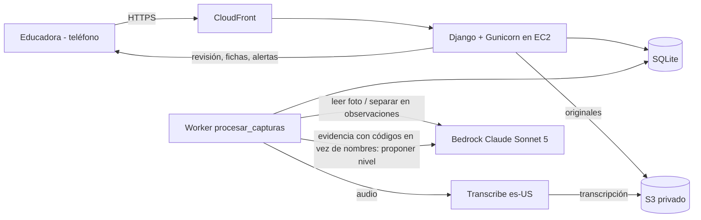

# Plan de implementación: Desafío 1 Fundación Integra

AWS Breaking Barriers Chile 2026. Entrega: viernes 16 de octubre, 14:00 (MVP + pitch de menos de 10 minutos).

## Problema

Las educadoras de Integra dedican unas 4 horas a la semana (más de 11.000 horas semanales en toda la institución) a transcribir y ordenar observaciones escritas a mano, para ubicar a cada niño en un nivel del 1 al 8 en cada núcleo de aprendizaje. El MVP:

- convierte notas, fotos y audios puntuales en observaciones ordenadas por niño;
- propone un nivel por núcleo con la evidencia que lo respalda;
- avisa cuando un niño va atrasado respecto de lo esperado o cuando faltan datos recientes.

La educadora siempre decide el nivel.

## Requisitos

### Modelo pedagógico

- 3 niveles educativos (sala cuna, medio, transición), cada uno con 8 núcleos y 8 niveles por núcleo. Según las Bases Curriculares, cada nivel abarca 2 años y sus OA describen lo esperado al final del tramo: 50 en sala cuna, 71 en medio y 85 en transición.
- Núcleos (Bases Curriculares 2018, confirmados por el Programa Pedagógico de Transición del MINEDUC): Identidad y Autonomía (IA), Convivencia y Ciudadanía (CC), Corporalidad y Movimiento (CM), Lenguaje Verbal (LV), Lenguajes Artísticos (LA), Exploración del Entorno Natural (EEN), Comprensión del Entorno Sociocultural (CES), Pensamiento Matemático (PM). En Transición suman 85 OA.
- La rúbrica se guarda por nivel educativo, porque puede variar entre ellos. La demo usa solo Transición (NT1 y NT2, 4 a 6 años), con una rúbrica provisoria derivada de las conductas observables del Programa Pedagógico de Transición (ver `contexto/hallazgos-programa-pedagogico-transicion.md`). Se reemplaza cuando Integra entregue la real.
- Mapeo provisorio de niveles: 1 = lo esperado al iniciar NT1; 2 a 4 = conductas de NT1, desde "con ayuda" hasta "autónomo"; 5 a 7 = lo mismo con las conductas de NT2; 8 = conductas de NT2 de forma autónoma (lo esperado al egresar).
- Todo niño entra al sistema en nivel 1 en los 8 núcleos. Solo la educadora cambia niveles.
- El tiempo se mide en semestres escolares, con fechas editables.
- Nivel esperado: tabla por curso, editable por la educadora, según el semestre de permanencia del niño. Valores por defecto: 1, 3, 5 y 7 para los semestres 1 a 4; al egresar se espera 8. No se asume que el avance sea lineal. Es una referencia blanda: las Bases Curriculares prescriben por tramos de 2 años porque una prescripción más corta "no respetaría diferencias individuales en el aprendizaje".
- Brecha = nivel esperado − nivel actual validado. Brecha 2: aviso. Más de 2: alerta. Ambos se redactan como sugerencias de revisión, "sin juicios perentorios", como piden las Bases Curriculares.
- Aviso de datos desactualizados si un núcleo de un niño pasa 14 días sin observaciones aceptadas, y aviso "sin datos" si nunca tuvo.
- Cobertura de evidencia por OA: para cada niño, cuántas observaciones aceptadas respaldan cada OA de su nivel educativo y la fecha de la más reciente. Los OA sin evidencia se destacan como sugerencia de qué observar.
- Vista del grupo por quincena (del 1 al 15 y del 16 a fin de mes, según la fecha de la observación). Por núcleo muestra las observaciones aceptadas del curso y cuántos niños tienen al menos una. Los núcleos sin observaciones se destacan, porque la Política de Calidad de Integra pide una oferta que cubra todos los núcleos en cada quincena. Se puede volver a quincenas anteriores.

### Captura y procesamiento

- La educadora registra desde su teléfono personal, con conexión: texto, foto (post-it o trabajo del niño) o audio corto. Sin video y sin grabación continua.
- Una nota que menciona a varios niños genera una observación por niño.
- Cada observación se etiqueta con sus núcleos y, cuando se pueda, con sus OA ("OA 4 LV"). Registra el nivel de apoyo (autónomo, con ayuda, parcial, no lo realiza o sin dato) y separa lo que el niño hizo o dijo de la interpretación de la educadora, como el registro anecdótico del programa.
- Las notas sobre el grupo completo (por ejemplo, "bajó la asistencia") quedan como contexto del curso y no se usan para evaluar.
- Los nombres se emparejan con la lista del curso, tolerando variantes de escritura (Naiara/Nayara). Si un nombre es ambiguo o desconocido, decide la educadora.
- El sistema propone un nivel actual por núcleo considerando toda la evidencia aceptada y citando las observaciones que lo respaldan. La educadora acepta, fija otro nivel o rechaza. Nada se aplica solo.
- Los archivos originales se guardan, y cada observación enlaza a su fuente.

### Alcance

- Dentro: perspectiva de la educadora (su curso), nivel Transición, un curso de 15 niños cargados a mano, datos 100% ficticios.
- Fuera del MVP (se mencionan en el pitch): vistas de directora y nacional, sugerencias de actividades, informes a familias, video, modo sin conexión, carga masiva de niños y otros niveles educativos.

### Equipo

- 5 personas: 4 de computación y 1 de ingeniería eléctrica. Conocen JS, CSS, HTML, SQLite, Flask y Django.
- Cuenta AWS de workshop compartida por el equipo, región us-east-1.

### Supuestos pendientes de confirmar

- La tabla de metas es por curso, no por niño.
- El mapeo provisorio de niveles a las conductas de NT1 y NT2 es una hipótesis nuestra.
- La rúbrica real y la referencia institucional del nivel esperado se piden a la directora de educación el jueves.
- El dataset sintético E-1 de la organización (`dataset-publico/`) usa otra rúbrica: 0 a 36 meses, 9 niveles y 5 dominios, con nivel esperado por edad. `contexto/PLAN_PIPELINE_IA.md` se basa en él. Falta decidir si la app también debe cargar ese catálogo, porque este plan supone 8 niveles por núcleo y nivel esperado por semestre. Si se carga, sus edades corresponden a sala cuna y parte de medio, cuyos OA oficiales están en las Bases Curriculares; ahí también hay una correspondencia aproximada entre sus 5 dominios y los 8 núcleos.

## Contexto

### Cuenta AWS (revisada el 14 de octubre)

- Rol `WSParticipantRole` en una cuenta de workshop, que puede borrarse al terminar el evento. Por eso la infraestructura va en una plantilla que se puede volver a ejecutar, y el código en git.
- Bedrock: el workshop solo permite algunos modelos. Sonnet 5.5 y Haiku 5.5 están bloqueados. `us.anthropic.claude-sonnet-5` fue probado y funciona. Haiku 4.5 (`us.anthropic.claude-haiku-4-5-20251001-v1:0`) está permitido como opción más barata.
- La simulación de permisos aprueba EC2, S3, KMS, CloudFront, Transcribe (incluido vocabulario personalizado), Polly (4 voces es-US) y creación de roles IAM. La simulación puede no reflejar todas las restricciones del evento.
- App Runner ya no acepta clientes nuevos; no se usa.

### Referente Curricular Integra 2025 (pp. 80–101)

- La evaluación tiene tres pasos: recoger información (observación y registro), juicio valorativo del equipo y toma de decisiones. La herramienta automatiza el primero y prepara el segundo.
- La documentación pedagógica oficial ya es multimodal: notas, fotos, audio, video, transcripción de lo que dicen los niños y sus trabajos.
- Pide registro objetivo: separar lo que el niño dijo o hizo de la interpretación.
- "Aprendizajes emergentes": una observación puede tocar núcleos distintos de los que buscaba la actividad.
- El documento presenta la documentación como un acto reflexivo. Mensaje para el pitch: eliminamos transcribir y ordenar, no la reflexión pedagógica.

### Política de Calidad Educativa de Integra (2017)

Detalle en `contexto/hallazgos-politica-calidad-educativa-integra.md`. El PDF no se versiona porque tiene derechos reservados.

- En 2017, el sistema de evaluación de Integra usaba tres instrumentos:
  - EEDP: desarrollo psicomotor de 0 a 2 años.
  - IEA "Evaluar para aprender": "niveles de logro y movilidad de los aprendizajes"; orienta la planificación y retroalimenta a las familias.
  - PLAEP-R: estandarizado, aplicado a una muestra.

  La herramienta registra la misma movilidad que mide el IEA. Falta confirmar si el instrumento de 8 niveles lo reemplazó.
- Define la calidad con centro en "el bienestar, el aprendizaje oportuno y pertinente y el protagonismo de los niños y niñas".
- Su vocabulario curricular es anterior a las Bases Curriculares 2018 y no se usa en la app.

### Bases Curriculares de la Educación Parvularia (MINEDUC, 2018)

PDF en `contexto/bases-curriculares-educacion-parvularia-2018.pdf`; detalle en `contexto/hallazgos-bases-curriculares.md`.

- Fijan oficialmente 8 núcleos y 3 niveles de 2 años. Los OA describen lo esperado al final de cada nivel: 206 en total (50 en sala cuna, 71 en medio y 85 en transición).
- Su enfoque de evaluación coincide con la herramienta:
  - la evidencia sale de situaciones cotidianas (fotografías, grabaciones, observaciones), sin instancias formales;
  - "reunidas las evidencias, el o la educadora debe construir una conclusión evaluativa", considerando la distancia entre lo que el niño hace y lo que plantea el OA;
  - todo "sin juicios perentorios".
- No traen conductas observables por año. Sus OA de sala cuna y medio son la fuente oficial si el alcance se amplía más allá de Transición.

### Programa Pedagógico de Transición (MINEDUC, 2019)

PDF en `contexto/programa-pedagogico-transicion-mineduc.pdf`; detalle en `contexto/hallazgos-programa-pedagogico-transicion.md`.

- Confirma los 8 núcleos y trae los 85 OA de Transición, cada uno con conductas observables separadas para NT1 y NT2: unas 500 en total, entre 1.000 y 2.000 palabras por núcleo. Caben en el prompt sin búsqueda vectorial.
- Por núcleo describe lo esperado al iniciar NT1 y cómo continúa en Enseñanza Básica.
- Trae formatos de registro (anecdótico, con foco en núcleo y OA, fotográfico) y una escala según autonomía: autónomo, con ayuda, parcial con ayuda, no lo realiza.
- No trae los 8 niveles de Integra ni cubre sala cuna o nivel medio.

### Por verificar durante la implementación

- Que Transcribe acepte los formatos de audio que graban los navegadores (WebM/Opus en Android, MP4 en iPhone). Task 9.
- La política de datos de Bedrock (no almacenar prompts ni usarlos para entrenar). Task 11.
- La fecha de entrada en vigencia de la Ley 21.719 de protección de datos personales. Task 11.

## Solución propuesta

### Stack

- Django 5 con SQLite. En producción se puede cambiar a PostgreSQL en RDS modificando solo la configuración.
- Interfaz: plantillas de Django + HTMX + Pico.css, guardados en `static/vendor` con versión fija (sin CDN).
- JavaScript simple para la cámara (input con `capture`) y el micrófono (MediaRecorder).
- Proceso de fondo como comando de Django (`manage.py procesar_capturas`) que lee la misma base de datos. Sin Celery ni Redis.
- Tests con pytest + pytest-django. Dependencias con versiones fijas.
- AWS: EC2 t3.small (Amazon Linux 2023) con rol IAM, S3 privado, Transcribe es-US, Bedrock (API Converse), CloudFront para HTTPS y SSM para acceso y despliegue (sin SSH). Todo en una plantilla CloudFormation.

### Arquitectura

### Flujo de procesamiento

1. La captura queda pendiente.
2. Se pasa a texto. El texto escrito se usa tal cual. Las fotos las lee Claude, que marca `[ilegible]` en vez de adivinar. Los audios los transcribe Transcribe, con los nombres del curso como vocabulario personalizado, y el resultado queda en nuestro bucket.
3. Claude separa el texto en observaciones y devuelve JSON (tool use obligatorio): nombre detectado, fecha, cita literal, núcleos, OA, nivel de apoyo, interpretación de la educadora (si la hay) y si es una nota grupal. El prompt incluye el catálogo de los 85 OA (código y texto).
4. Los nombres se emparejan con la lista del curso en nuestro código, no en el modelo, usando alias y comparación aproximada (difflib). Así el resultado es predecible y testeable.
5. La educadora revisa: acepta, edita o descarta cada observación y resuelve nombres ambiguos.
6. Para proponer un nivel se envían a Claude las conductas de NT1 y NT2 del núcleo, lo esperado al iniciar NT1, el mapeo de niveles, el nivel validado actual y las observaciones aceptadas con su nivel de apoyo, con códigos en lugar de nombres. Claude devuelve nivel, observaciones citadas, conductas del programa que se observan, justificación breve y si la evidencia es suficiente. Se valida que el nivel esté entre 1 y 8 y que las citas correspondan a observaciones enviadas.
7. Las alertas y la cobertura de evidencia se calculan cada vez que se piden; no se guardan.

### Entidades

- `Nucleo` (nombre, sigla); `DescriptorNivel` (nivel educativo, núcleo, nivel 1–8, descripción; generado con el mapeo provisorio).
- `ObjetivoAprendizaje` (nivel educativo, núcleo, número, texto; se cita como "OA 4 LV"); `Manifestacion` (OA, año NT1 o NT2, texto observable).
- `Jardin`; `Curso` (nivel educativo, educadora); `Semestre` (inicio, fin); `MetaSemestre` (curso, semestre de permanencia, nivel esperado).
- `Nino` (curso, nombre, alias, código seudónimo, fecha de ingreso).
- `Captura` (tipo, archivo, texto extraído, estado, error).
- `Observacion` (captura, niño o vacío, nombre detectado, fecha, cita literal, interpretación, núcleos, OA, nivel de apoyo, grupal, estado).
- `PropuestaNivel` (niño, núcleo, nivel, justificación, observaciones citadas, estado).
- `NivelValidado` (niño, núcleo, nivel, fecha, validado por, propuesta de origen). Forma el historial; el nivel actual es el más reciente.

### Seguridad y privacidad

- Todas las vistas piden login. La educadora solo ve sus cursos (filtro en todas las consultas). El panel de administración es solo para staff.
- Los originales se muestran con URLs prefirmadas de 5 minutos, después de verificar permisos.
- S3 con bloqueo de acceso público y cifrado. Las transcripciones quedan en nuestro bucket.
- El servidor solo acepta tráfico que venga de CloudFront. Sin puerto 22; acceso por SSM.
- Riesgo aceptado para el MVP: el tramo entre CloudFront y EC2 va por HTTP sin cifrar. Es aceptable con datos ficticios; en producción se agrega TLS hasta el servidor (ALB + ACM).
- Al proponer un nivel, Bedrock nunca recibe el nombre junto con la evaluación. Al separar observaciones sí ve nombres, porque están escritos en la nota.

## Tareas

### Task 1: Esqueleto Django, modelo de datos y datos de demo

- Objetivo: el proyecto corre en local con el modelo pedagógico cargado.
- Guía:
  - Proyecto `config` y app `registro`, con versiones fijas en `requirements.txt`.
  - Modelos `Nucleo`, `DescriptorNivel`, `ObjetivoAprendizaje`, `Manifestacion`, `Jardin`, `Curso`, `Semestre`, `MetaSemestre`, `Nino` y `NivelValidado`, con restricciones (nivel entre 1 y 8, unicidad) y registrados en el panel de administración.
  - `datos/curriculo_transicion.json`, extraído de `contexto/programa-pedagogico-transicion-mineduc.pdf` con `scripts/extraer_curriculo.py` (pdftotext más parseo) y revisado a mano: 8 núcleos con sigla y trayectoria, 85 OA y sus conductas de NT1 y NT2. Lo puede hacer la persona de IA en paralelo.
  - Al crear un niño se crea automáticamente su nivel 1 en los 8 núcleos.
  - Comando `cargar_demo`, que se puede correr varias veces sin duplicar datos, y que carga desde `datos/`:
    - los 8 núcleos, los 85 OA con sus conductas y la rúbrica provisoria de Transición (8×8, generada con el mapeo provisorio y marcada como provisoria);
    - semestres desde 2025-2 hasta 2026-2;
    - 1 jardín y 1 curso de Transición de 15 niños, con casos difíciles (Naiara/Nayara, dos Sofías, ingresos en distintos semestres);
    - una usuaria educadora de prueba.
  - Login de Django. `.gitignore` que excluya la base de datos, `.env` y los archivos subidos.
- Tests: restricciones de los modelos, que `cargar_demo` no duplique datos, que se cree el nivel 1 inicial y que el currículo tenga 8 núcleos y 85 OA, cada uno con conductas de NT1 y NT2.
- Demo: después de `cargar_demo`, el panel de administración muestra el curso, los niños, los OA y la rúbrica.

### Task 2: Nivel esperado, brechas y vista del curso

- Objetivo: una tabla de 15 niños por 8 núcleos con nivel actual, nivel esperado y alertas.
- Guía:
  - `registro/alertas.py` con funciones puras:
    - semestre de permanencia, contando desde el semestre de ingreso (inclusive);
    - nivel esperado según la tabla del curso (después del semestre 4, siempre 8);
    - brecha y gravedad (0–1 normal, 2 aviso, más de 2 alerta);
    - "datos de más de 14 días" y "sin datos".
  - Modelos mínimos `Captura` y `Observacion` (niño, fecha, cita, núcleos, OA, estado).
  - Unas 40 observaciones aceptadas, etiquetadas con núcleos y OA, y niveles históricos en los datos de demo, para que aparezcan todos los estados. Algunos OA quedan sin evidencia a propósito.
  - Vista del curso con permisos. Las alertas se muestran con color y también con texto, por accesibilidad, y se redactan como sugerencias (por ejemplo, "Revisar: 3 niveles bajo lo esperado"), no como diagnóstico.
  - Sobre la tabla, el resumen de la quincena: por núcleo, observaciones aceptadas y niños con al menos una, con los núcleos sin observaciones destacados y navegación a quincenas anteriores. Función pura `cobertura_quincena` en `registro/cobertura.py`.
- Tests: escritos antes que el código, cubriendo bordes: brecha 2 frente a 3; 14 frente a 15 días; ingreso a mitad de semestre; fechas de vacaciones fuera de todo semestre; límites de quincena (día 15 frente a 16, fin de mes y febrero). Otra educadora recibe 404.
- Demo: al entrar, aparece la tabla con las alertas y el resumen de la quincena con los núcleos sin observaciones.

### Task 3: Ficha del niño, validación manual y tabla de metas

- Objetivo: el flujo completo funciona sin IA.
- Guía:
  - Ficha con los 8 núcleos (actual frente a esperado), el historial de niveles validados y las observaciones aceptadas con fecha y cita.
  - En cada núcleo de la ficha, la cobertura de evidencia de sus OA: cantidad de observaciones aceptadas y fecha de la más reciente, con los OA sin evidencia destacados como sugerencia de qué observar. Se calcula con funciones puras en `registro/cobertura.py`.
  - Formulario con HTMX para fijar un nivel con un comentario (crea un `NivelValidado` con la usuaria).
  - Pantalla para editar la tabla de metas del curso.
  - Diseño pensado primero para celular, con Pico.css.
- Tests: validar un nivel crea historial y actualiza la tabla; editar metas cambia las alertas; la cobertura por OA cuenta solo observaciones aceptadas del niño y toma la fecha más reciente; permisos.
- Demo: se sube un nivel a mano y la alerta desaparece; la ficha muestra qué OA todavía no tienen evidencia.

### Task 4: Infraestructura y despliegue

- Objetivo: una URL con HTTPS que se puede abrir desde un teléfono, con lo hecho en la Task 3.
- Guía:
  - `infra/plantilla.yaml` (CloudFormation) con:
    - bucket S3 con bloqueo de acceso público y cifrado, con prefijos `originales/`, `transcripciones/` y `releases/`;
    - rol de instancia con permisos mínimos: S3 solo en ese bucket; Transcribe (iniciar y consultar trabajos, crear y actualizar vocabularios); `bedrock:InvokeModel` solo para los perfiles de inferencia de Sonnet 5 y Haiku 4.5 y sus modelos subyacentes; política administrada de SSM;
    - security group que solo acepta el puerto de Gunicorn desde la prefix list `com.amazonaws.global.cloudfront.origin-facing`;
    - instancia EC2 t3.small (Amazon Linux 2023) con user data que instala Python, crea el entorno y registra dos servicios systemd (web y proceso de fondo);
    - distribución CloudFront con las políticas administradas `CachingDisabled` y `AllViewerAndCloudFrontHeaders-2022-06`.
  - Django en producción: DEBUG apagado; `ALLOWED_HOSTS` y `CSRF_TRUSTED_ORIGINS` con el dominio de CloudFront; `SECURE_PROXY_SSL_HEADER` con `CloudFront-Forwarded-Proto`; WhiteNoise para archivos estáticos; `SECRET_KEY` generada en el servidor y fuera de git.
  - `scripts/desplegar.sh`: `git archive` → S3 `releases/` → `aws ssm send-command` que descarga, instala dependencias, migra, recopila estáticos y reinicia los servicios.
  - Pedir confirmación al usuario antes de crear recursos en AWS.
- Tests: `manage.py check --deploy` sin problemas críticos, cfn-lint sobre la plantilla y un curl a `/login`.
- Demo: en el teléfono, entrar y ver la tabla del curso.

### Task 5: Captura de texto y separación en observaciones con Bedrock

- Objetivo: una nota escrita genera observaciones pendientes, una por niño.
- Guía:
  - Cliente de Bedrock en `registro/ia/bedrock.py`: API Converse con tool use obligatorio, modelo elegido por variable de entorno, reintentos con espera creciente y tiempo máximo; reemplazable por un cliente falso en los tests.
  - Prompt de separación en un archivo del repo. Recibe texto, fecha de captura, nombres de pila del curso como pista y el catálogo de núcleos y OA. Devuelve una lista de {nombre_detectado, fecha, cita_literal, interpretacion, núcleos[], oas[], apoyo, grupal}. Se valida el JSON y se descartan los códigos de OA que no existen.
  - `registro/coincidencia.py`: normaliza (tildes, mayúsculas), revisa alias exactos y luego comparación aproximada con difflib sobre un umbral. Si hay ambigüedad, la observación queda sin niño asignado.
  - `manage.py procesar_capturas`: bucle que toma una captura pendiente a la vez con una actualización condicional (dos procesos no toman la misma), registra estado y error visibles y permite reintentar.
  - Formulario para capturar texto.
  - Unas 20 notas de prueba, escritas a partir de conductas del programa, con el resultado esperado (niños, núcleos, OA y apoyo) en `datos/eval/`.
  - Prototipar el prompt con las notas de `contexto/ocr-presentacion.md`.
- Tests: Naiara/Nayara se reconocen como la misma niña; "Sofía" queda ambigua porque hay dos; un nombre desconocido queda sin asignar; una nota sobre 3 niños genera 3 observaciones; una nota grupal queda como contexto; un código de OA inexistente se descarta; un JSON inválido marca error y permite reintentar.
- Demo: se escribe "Pedro y Emilio clasificaron hojas por color" y aparecen 2 observaciones pendientes.

### Task 6: Pantalla de revisión

- Objetivo: la educadora revisa lo pendiente en segundos desde el teléfono.
- Guía:
  - Observaciones pendientes del curso agrupadas por captura, cada una con niño, fecha, cita, interpretación, núcleos, OA y nivel de apoyo editables. Si no tiene niño asignado, se elige de una lista.
  - Acciones con HTMX: aceptar, editar, descartar y "aceptar todas" por captura.
  - Las notas grupales van en una sección de contexto.
  - Contador de pendientes en la barra de navegación.
  - Las observaciones aceptadas alimentan la ficha y las alertas.
- Tests: aceptar, descartar y reasignar; no se puede actuar sobre observaciones de otro curso; aceptar actualiza el aviso de 14 días.
- Demo: se escribe una nota, se revisa, aparece en la ficha y desaparece el aviso de datos desactualizados.

### Task 7: Propuesta de nivel con nombres reemplazados por códigos

- Objetivo: el sistema propone el nivel actual de un núcleo con su evidencia.
- Guía:
  - Modelo `PropuestaNivel`.
  - `registro/ia/seudonimo.py` reemplaza en las citas todos los nombres y alias del curso por códigos.
  - El prompt incluye, para el nivel educativo del niño, las conductas de NT1 y NT2 del núcleo, lo esperado al iniciar NT1 y el mapeo de niveles; además, el nivel validado actual y las observaciones aceptadas (id, fecha, cita, OA y nivel de apoyo). La salida es nivel, ids citados, conductas del programa que se observan, justificación breve y si la evidencia es suficiente. Se valida (nivel 1–8, citas dentro de las enviadas). Si la evidencia no alcanza, se muestra "faltan observaciones" en vez de un nivel.
  - Se pide una propuesta automáticamente al aceptar observaciones nuevas de ese núcleo, y con un botón en la ficha. La procesa el proceso de fondo.
  - En la ficha: propuesta con citas enlazadas. La educadora acepta (crea un `NivelValidado` ligado a la propuesta), fija otro nivel o rechaza. Nunca se aplica sola.
- Tests: ningún nombre del curso aparece en lo enviado a Bedrock; validación de la respuesta; flujo de aceptar y rechazar con cliente falso.
- Demo: tras aceptar 3 observaciones de lenguaje de Sofía, aparece una propuesta de nivel 3 con sus citas; al aceptarla, la tabla se actualiza.

### Task 8: Captura por foto

- Objetivo: la foto de un post-it genera observaciones pendientes que enlazan a la foto.
- Guía:
  - `<input type="file" accept="image/*" capture="environment">`; el navegador achica la foto a unos 1600 px en JPEG con canvas, para quedar bajo el límite de imagen de Bedrock y subir rápido.
  - django-storages: disco en desarrollo y S3 en producción.
  - El proceso de fondo transcribe la foto tal cual con Claude (`[ilegible]` en vez de adivinar) y luego aplica la misma separación de la Task 5.
  - Vista del original con URL prefirmada de 5 minutos y verificación de permisos.
  - El equipo escribe a mano unos 10 post-its de prueba (textos generados en `datos/eval/`) y los fotografía. Las fotos de la diapositiva 5 de la presentación sirven para probar la lectura de letra real, pero no se cargan en la demo.
- Tests: se procesa una captura de tipo foto con cliente falso; otra usuaria no puede ver el original; se rechazan archivos de tipo o tamaño inválido.
- Demo: se fotografía un post-it con el teléfono y la revisión muestra el enlace a la foto.

### Task 9: Captura por audio

- Objetivo: la educadora dicta una observación y queda pendiente de revisión.
- Guía:
  - Botón de grabar y detener con MediaRecorder, límite de 2 minutos, botones con etiquetas y estado de la grabación mostrado en texto. Se sube a S3.
  - Verificar que Transcribe acepte los formatos de los teléfonos (WebM/Opus en Android, MP4 en iPhone). Si alguno no sirve, convertirlo en el proceso de fondo.
  - Trabajo de transcripción en es-US con vocabulario personalizado del curso (se crea o actualiza cuando cambian los niños), salida en nuestro bucket bajo `transcripciones/`, consulta periódica hasta que termine, y luego la separación de la Task 5.
  - Audios de prueba generados con Polly a partir de las notas de `datos/eval/`.
- Tests: transcripción exitosa, fallida y que no termina a tiempo, con un cliente de Transcribe falso; el vocabulario usa solo caracteres válidos.
- Demo: se dicta "Rubí cruzó el circuito sin ayuda" y aparece una observación pendiente con el audio enlazado.

### Task 10: Medición de calidad y ajuste de prompts

- Objetivo: cifras de precisión para el pitch y prompts afinados.
- Guía:
  - `manage.py evaluar` corre todo el set de prueba (texto, fotos y audios) contra Bedrock real y mide: porcentaje de niños bien asignados, precisión y cobertura de núcleos y de OA, porcentaje de propuestas a ±1 nivel del esperado y tiempo por captura.
  - Iterar los prompts y comparar Sonnet 5 con Haiku 4.5 en calidad, latencia y costo.
- Tests: las métricas se calculan bien sobre resultados conocidos (con cliente falso).
- Demo: tabla de resultados.

### Task 11: Demo final y pitch

- Objetivo: una demo confiable y un pitch de menos de 10 minutos.
- Guía:
  - Volver a cargar los datos de demo en producción.
  - Guion: nota, foto y audio → revisión → propuesta → validación → tabla, mostrando el tiempo que toma.
  - Láminas:
    - problema (4 h semanales por educadora);
    - solución y cómo encaja en el sistema de evaluación de Integra: registra la movilidad de los aprendizajes que mide el IEA y apunta a su definición de calidad (bienestar, aprendizaje oportuno y pertinente, protagonismo);
    - demo;
    - rúbrica (basada en el Programa Pedagógico de Transición del MINEDUC y reemplazable por la de Integra), y enfoque de evaluación alineado con las Bases Curriculares (evidencia cotidiana, la educadora concluye);
    - privacidad (códigos en vez de nombres, originales cifrados, la educadora decide, ley de datos personales);
    - cifras de la Task 10;
    - cómo escala (vistas de directora y nacional, video, modo sin conexión, informes a familias, otros niveles educativos).
  - Verificar la política de datos de Bedrock y la vigencia de la Ley 21.719 antes de citarlas.
  - Para el costo, usar la calculadora de precios de AWS.
  - Grabar un video de respaldo. Congelar el código a las 11:00.
- Demo: ensayo completo cronometrado.

## Reparto y horario

| Rol | Tareas |
|---|---|
| Backend | 1, 2 (lógica), 3 (lógica), 7 (flujo) |
| Frontend 1 | 3 (ficha), 6, 9 (grabación) |
| Frontend 2 | 2 (tabla), 8 (cámara), 11 (láminas) |
| IA | 1 (currículo), 5, 7 (prompt), 8 (lectura de fotos), 9 (Transcribe), 10 |
| Eléctrica | 4, 11 (guion y video), apoyo en 9 |

Cuando esté lista la Task 1 (miércoles cerca de las 22:00), todos pueden trabajar en paralelo sobre los mismos modelos.

- Miércoles en la noche: Task 1 (incluida la extracción del currículo); se empiezan la 2, la 4 y los prompts de la 5.
- Jueves:
  - 09:00, reunión con la directora de educación.
  - 13:00, tareas 2 a 5 listas y URL en vivo.
  - En la tarde, tareas 6, 7 y 8.
  - En la noche, tareas 9 y 10 y carga de la demo.
- Viernes: Task 11, código congelado a las 11:00, presentación a las 14:00.

## Preguntas para la directora de educación (jueves 09:00)

1. ¿Nos puede pasar la rúbrica completa (descriptores y conductas observables)? ¿Cambia entre niveles educativos?
2. ¿Hay una referencia institucional del nivel esperado por semestre, o lo define cada educadora? ¿Por curso o por niño?
3. ¿Qué protocolo siguen cuando detectan un rezago?
4. ¿Las familias firman un consentimiento para fotos y audios?
5. Mostrarle la pantalla de revisión y preguntar si la usarían así en la sala.
6. ¿El instrumento de 8 niveles se construyó sobre los OA y las conductas del Programa Pedagógico de Transición del MINEDUC? ¿Le hace sentido nuestro mapeo provisorio de niveles?
7. ¿El instrumento de 8 niveles reemplaza al IEA "Evaluar para aprender"? ¿La EEDP se sigue aplicando en sala cuna?
